# SupplyMesh — Global Procurement & Supplier Intelligence Platform

### Technical Product Blueprint

---

## 📖 Start Here (60-second summary)

**The problem.** Companies buy from hundreds of suppliers using spreadsheets and email. Nobody can see what is happening, rules aren't enforced, and there is no history of who approved what.

**The solution.** SupplyMesh turns every purchase into a **chain of controlled documents**:


Every step in that chain is:

| Property         | Meaning in plain English                                     |
| ---------------- | ------------------------------------------------------------ |
| **Permissioned** | Only the right people can do each action                     |
| **Stateful**     | Each document has a clear status (Draft → Approved → Paid …) |
| **Auditable**    | Every change is logged: who, what, when, before/after        |
| **Isolated**     | Company A can never see Company B's data                     |

### Glossary (words used in this document)

| Term                      | Meaning                                                                         |
| ------------------------- | ------------------------------------------------------------------------------- |
| **Tenant / Organization** | One customer company using SupplyMesh                                           |
| **PR**                    | Purchase Request — "I need to buy X"                                            |
| **PO**                    | Purchase Order — the official order sent to a supplier                          |
| **Goods Receipt**         | Recording that the goods actually arrived                                       |
| **Three-way match**       | Checking that **PO = Receipt = Invoice** before paying                          |
| **RBAC**                  | Role-Based Access Control — permissions are given through roles                 |
| **RLS**                   | Row-Level Security — the database itself hides other companies' rows            |
| **ADR**                   | Architecture Decision Record — a short note explaining _why_ we chose something |
| **Outbox**                | A table that safely queues events (emails, etc.) so none are ever lost          |
| **Idempotency key**       | A unique token that makes a retried request safe (no double payment)            |

### Colour legend used in diagrams

| Colour    | Meaning                               |
| --------- | ------------------------------------- |
| 🟦 Blue   | A person / user action                |
| 🟩 Green  | Success / approved / final good state |
| 🟥 Red    | Rejected / error / blocked            |
| 🟨 Yellow | A decision or check                   |
| ⬜ Grey   | System / automatic action             |

### Where to find each deliverable

| #   | Deliverable                          | Section                                     |
| --- | ------------------------------------ | ------------------------------------------- |
| 1   | Product Feature Specification        | [§1](#1-product-feature-specification)      |
| 2   | User Journey Diagrams                | [§2](#2-user-journey-diagrams)              |
| 3   | Complete ER Diagram                  | [§3.2](#32-er-diagrams-one-per-area)        |
| 4   | Database Schema Documentation        | [§3.3 – §3.9](#33-table-reference)          |
| 5   | High-Level Architecture Diagram      | [§4.2](#42-the-big-picture-diagram)         |
| 6   | System Design Diagrams (4 workflows) | [§5](#5-critical-workflows)                 |
| 7   | API Structure Proposal               | [§6](#6-api-structure)                      |
| 8   | Technical Decision Records (ADRs)    | [§7](#7-architecture-decision-records-adrs) |
| 9   | MVP vs Future Scope                  | [§8](#8-mvp-vs-future-scope)                |
| 10  | Risk and Scalability Analysis        | [§9](#9-risk-and-scalability-analysis)      |

---

## 1. Product Feature Specification

### 1.1 Features at a glance

**Core features (must exist for the product to work)**

| ID   | Feature                       | What it does                                                                     |
| ---- | ----------------------------- | -------------------------------------------------------------------------------- |
| F-01 | Multi-tenancy & Organizations | Every record belongs to exactly one company. Data is invisible across companies. |
| F-02 | Identity & Access             | Users, invitations, departments, roles, permissions.                             |
| F-03 | Supplier Management           | Register suppliers, upload documents, verify, and manage status.                 |
| F-04 | Purchase Requests             | Employees request items with cost, quantity, priority, delivery date.            |
| F-05 | Approval Workflow Engine      | Configurable, multi-step approvals based on amount and department.               |
| F-06 | Purchase Orders               | Create POs from approved requests; issue, receive, close.                        |
| F-07 | Invoices & Payments           | Record invoices, three-way match, handle discrepancies, track payments.          |
| F-08 | Supplier Intelligence         | On-time delivery, completion rate, discrepancy rate, reliability score.          |
| F-09 | Organization Analytics        | Spend by department/supplier, pending requests, approval speed.                  |
| F-10 | Audit Logging                 | Permanent record of every change, with before/after snapshots.                   |
| F-11 | Notifications                 | In-app and email messages triggered by events.                                   |

**Secondary features (valuable, but come later)**

| ID   | Feature                 | What it does                                                |
| ---- | ----------------------- | ----------------------------------------------------------- |
| S-01 | Supplier portal         | Suppliers upload documents and acknowledge POs themselves.  |
| S-02 | Contract management     | Contracts linked to suppliers, with renewal reminders.      |
| S-03 | Budget tracking         | Requests checked against department budgets.                |
| S-04 | Saved reports & exports | Scheduled CSV/PDF exports.                                  |
| S-05 | Approval delegation     | A manager hands approval power to someone for a date range. |
| S-06 | Bulk import             | Import suppliers and historical spend from CSV.             |
| S-07 | Comment threads         | Discussion on each document.                                |
| S-08 | Saved views             | Personal/shared filters on lists.                           |

### 1.2 Who can do what (role matrix)

| Action                                            |     👑 Owner     |  🛒 Procurement Mgr  |       🏢 Dept Manager       | 💰 Finance Officer | 👤 Employee |
| ------------------------------------------------- | :--------------: | :------------------: | :-------------------------: | :----------------: | :---------: |
| Manage organization, departments, roles           |        ✅        |          ❌          |             ❌              |         ❌         |     ❌      |
| Invite / deactivate users                         |        ✅        |          ❌          |             ❌              |         ❌         |     ❌      |
| Add suppliers, verify documents, activate/suspend |        ❌        |          ✅          |             ❌              |         ❌         |     ❌      |
| Create purchase requests                          |        ❌        |          ❌          |        ✅ (own dept)        |         ❌         |     ✅      |
| Approve purchase requests                         |       ❌ ¹       |    ✅ (escalated)    | ✅ (own dept, within limit) |         ❌         |     ❌      |
| Design approval workflows                         | ✅ (sets policy) |          ✅          |             ❌              |         ❌         |     ❌      |
| Create / issue purchase orders                    |        ❌        |          ✅          |             ❌              |         ❌         |     ❌      |
| Record goods receipts                             |        ❌        |          ✅          |             ❌              |         ❌         |     ❌      |
| Record invoices, run three-way match              |        ❌        |          ❌          |             ❌              |         ✅         |     ❌      |
| Approve invoices, record payments                 |        ❌        |          ❌          |             ❌              |         ✅         |     ❌      |
| View analytics                                    |      ✅ all      | ✅ procurement spend |         ✅ own dept         |   ✅ expenditure   |     ❌      |
| View audit logs                                   |        ✅        |          ❌          |             ❌              |         ❌         |     ❌      |
| Track own requests                                |        ✅        |          ✅          |             ✅              |         ✅         |     ✅      |

¹ The Owner cannot approve requests (segregation of duties) **unless** explicitly given an approver role.

**Extra restrictions to remember**

- A Department Manager can **never approve their own request**.
- A Finance Officer **cannot create requests or POs** (the person who spends must not be the person who pays).
- An Employee **cannot see** other departments' requests, supplier financials, or analytics.

### 1.3 Business rules

| ID    | Rule (plain English)                                                                                                     | Enforced by                     |
| ----- | ------------------------------------------------------------------------------------------------------------------------ | ------------------------------- |
| BR-01 | Every record carries `organization_id`. No query may cross companies.                                                    | App scope + database RLS        |
| BR-02 | Approval route depends on **amount + department + document type**.                                                       | Approval engine                 |
| BR-03 | Approval steps run **one after another**, unless a step is marked parallel.                                              | Approval engine                 |
| BR-04 | You **cannot approve something you created**.                                                                            | Approval engine + service check |
| BR-05 | A request becomes a PO only if its approval is **approved**.                                                             | Service layer + foreign key     |
| BR-06 | A PO can only go to a supplier whose status is **active**.                                                               | Service layer                   |
| BR-07 | An invoice is approved only if the three-way match **passes**, or a Finance Officer **overrides with a written reason**. | Invoice service                 |
| BR-08 | Payment only against an **approved** invoice; total payments can **never exceed** the invoice total.                     | DB trigger + service check      |
| BR-09 | Money is stored as `NUMERIC(18,4)`; **only the server does arithmetic**.                                                 | Schema + DTOs                   |
| BR-10 | Every status change writes an audit row **in the same transaction**.                                                     | Repository decorator            |
| BR-11 | Small requests may skip procurement review, but **never** skip department approval.                                      | Workflow config                 |
| BR-12 | A rejected/cancelled request **cannot be reopened**. Create a new one.                                                   | State machine                   |

### 1.4 Lifecycles (status flows)

_Purchase Request lifecycle._


_Purchase Order lifecycle._


_Invoice lifecycle._


_Supplier lifecycle. A supplier cannot jump straight from "pending" to "active"._


### 1.5 Feature dependencies


🟩 Green = **MVP critical path** (F-01 → F-07, nothing else can ship first). 🟨 Yellow = features that _read_ from the chain.

### 1.6 Known limitations (by design)

| #   | Limitation                                                                   | Why we accept it for now                                          |
| --- | ---------------------------------------------------------------------------- | ----------------------------------------------------------------- |
| L-1 | One shared database for all tenants                                          | Cheaper and simpler. Protected by RLS and per-tenant rate limits. |
| L-2 | Workflows = ordered steps with amount/role conditions (not free-form graphs) | Covers ~90% of real policies. Full BPMN is overkill.              |
| L-3 | Three-way match uses rules and tolerances, not AI                            | Finance teams need explainable, deterministic results.            |
| L-4 | No offline / mobile app                                                      | Procurement is a desk job. Web-first.                             |
| L-5 | One currency per organization                                                | Multi-currency adds large accounting complexity.                  |
| L-6 | No native ERP integration                                                    | Export + API available. Deep integration is a later sales item.   |

### 1.7 MVP scope and prioritisation

**The MVP test:** _Can a purchase be created, approved, ordered, invoiced and paid — with a complete audit trail and correct permissions — end to end?_ If yes, it's MVP.

| Priority                    | Features                                                                                                                                                | Why                                                               |
| --------------------------- | ------------------------------------------------------------------------------------------------------------------------------------------------------- | ----------------------------------------------------------------- |
| 🟥 **Must have (MVP)**      | Tenancy, RBAC, suppliers + verification, requests, approval engine, POs, invoices + three-way match, payments, audit log, notifications, core analytics | Without these the chain is broken. This _is_ the product.         |
| 🟧 **Should have**          | Supplier performance scoring, richer dashboards, email digest, comments, saved views, document-expiry alerts                                            | High value; chain still works without them. Ship right after MVP. |
| 🟨 **Could have**           | Supplier portal, contracts, budgets, delegation, bulk import, exports                                                                                   | Useful for large customers, not needed to prove the model.        |
| ⬜ **Won't have (for now)** | ML risk prediction, e-auctions/RFQ, ERP connectors, mobile app, multi-currency, offline mode                                                            | Too complex or needs data/scale we don't have yet.                |

**Future phases**

| Phase   | Adds                                                                                                          |
| ------- | ------------------------------------------------------------------------------------------------------------- |
| Phase 2 | Supplier portal, contracts, budgets, delegation, CSV import, SSO/SAML                                         |
| Phase 3 | Multi-currency + FX, ERP connectors (SAP, NetSuite, QuickBooks), e-signature, ML risk scoring, e-auctions/RFQ |
| Phase 4 | Marketplace/catalogue buying, ESG scoring, data-warehouse export, white-label partner mode                    |

---

## 2. User Journey Diagrams

> Each diagram is split into **lanes** (who does the step). Read top to bottom.

### 2.1 Journey 1 — Supplier registration & verification

<p align="center">
</p>

<!-- ### 2.1 Journey 1 — Supplier registration & verification

 -->

### 2.2 Journey 2 — Purchase request & multi-level approval

<!--  -->
<p align="center">

</p>

### 2.3 Journey 3 — Purchase order → invoice → payment


---

## 3. Database Design

### 3.1 The big picture (how the tables are grouped)

The database has **22 tables in 6 groups**. Arrows mean "points to / is needed by".


**Three rules apply to almost every table:**

1. Primary key is a `uuid` (auto-generated).
2. Every business table has `organization_id NOT NULL` (the tenant marker).
3. Money columns are `NUMERIC(18,4)` — never floating point.

### 3.2 ER diagrams (one per area)

> **How to read an ER diagram:** each box is a table. `PK` = primary key (the row's ID), `FK` = foreign key (a link to another table).
> Symbols on the lines: `||` = exactly one, `o|` = zero or one, `|{` = one or many, `o{` = zero or many.
> Example: `ORGANIZATIONS ||--o{ USERS` means _one organization has many users_.
> Only key columns are drawn here. Full column lists are in [§3.3](#33-table-reference).

#### ER 1 — Identity & Access (who can log in and what they can do)


**In plain words:** a company has departments and users. Users get **roles**; roles bundle **permissions**. `scope_department_id` limits a role to one department (e.g. a Department Manager only approves for _their_ department).

#### ER 2 — Suppliers

<!--  -->
<p align="center">

</p>

**In plain words:** a supplier has uploaded documents (checked before activation) and a performance record per period (calculated nightly).

#### ER 3 — Purchase requests & approvals


**In plain words:**

- A **workflow** is the _rulebook_ ("over $5,000 needs two approvers").
- An **instance** is one _live approval_ of one document, following that rulebook.
- **Actions** are the individual approve/reject votes.
- `entity_type` + `entity_id` let one approval engine serve requests, POs and invoices (that is why it is not a normal FK).

#### ER 4 — Orders, invoices & payments (the money chain)

<!--  -->
<p align="center">

</p>

**In plain words:** one request becomes (at most) one PO. One PO can have many invoices (suppliers often bill in parts). One invoice can have many payments (partial payments).

#### ER 5 — Support tables (audit, notifications, events, files)


### 3.3 Table reference

> **Column legend.** `PK` primary key · `FK` foreign key · `req` = required (NOT NULL) · `opt` = optional (may be empty) · `money` = `NUMERIC(18,4)`.
> `organization_id` (required, FK → organizations) exists on every table below **except** `organizations` and `permissions`, so it is only listed where it matters.

#### Group 1 — Identity & Access

**`organizations`** — one row per customer company.

| Column                 | Type      | Rules              | Plain meaning                               |
| ---------------------- | --------- | ------------------ | ------------------------------------------- |
| id                     | uuid      | PK                 | Company ID                                  |
| name                   | text      | req                | Company name                                |
| slug                   | text      | req, unique        | Short URL-friendly name                     |
| status                 | text      | req                | `active` · `suspended` · `deleted`          |
| base_currency          | char(3)   | req, default `USD` | The company's single currency               |
| settings               | JSON      | req, default `{}`  | Thresholds, match tolerances, feature flags |
| created_at, updated_at | timestamp | req                | When created / last changed                 |

**`users`** — people who log in.

| Column                | Type      | Rules                    | Plain meaning                                           |
| --------------------- | --------- | ------------------------ | ------------------------------------------------------- |
| id                    | uuid      | PK                       |                                                         |
| organization_id       | uuid      | FK, req                  | Which company                                           |
| department_id         | uuid      | FK, opt                  | Which department (cleared if dept deleted)              |
| email                 | citext    | req                      | Case-insensitive email                                  |
| password_hash         | text      | opt                      | Empty while invite pending or SSO                       |
| first_name, last_name | text      | req                      |                                                         |
| status                | text      | req                      | `invited` · `active` · `suspended` · `deactivated`      |
| last_login_at         | timestamp | opt                      |                                                         |
| _Unique_              |           | (organization_id, email) | Same email can exist in two companies, not twice in one |

**`departments`**

| Column               | Type  | Rules                   | Plain meaning      |
| -------------------- | ----- | ----------------------- | ------------------ |
| id                   | uuid  | PK                      |                    |
| parent_department_id | uuid  | FK → departments, opt   | Builds a hierarchy |
| manager_user_id      | uuid  | FK → users, opt         | Head of department |
| name, code           | text  | req                     |                    |
| budget_amount        | money | opt                     | Budget envelope    |
| _Unique_             |       | (organization_id, code) |                    |

**`roles`** — a named bundle of permissions, defined per company.

| Column                 | Type      | Rules                   | Plain meaning                              |
| ---------------------- | --------- | ----------------------- | ------------------------------------------ |
| id                     | uuid      | PK                      |                                            |
| organization_id        | uuid      | FK → organizations, req | Which company defines the role             |
| name                   | text      | req                     | Role label, e.g. `Procurement Manager`     |
| description            | text      | opt                     | What the role is for                       |
| is_system_role         | boolean   | req, default false      | Seeded role that cannot be deleted         |
| created_at, updated_at | timestamp | req                     | When created / last changed                |
| _Unique_               |           | (organization_id, name) | No duplicate role names inside one company |

System roles (Owner, Procurement Manager, Dept Manager, Finance Officer, Employee) are seeded per company; custom roles can be added.

**`permissions`** — the global catalogue of atomic actions. Not tenant-scoped.

| Column      | Type      | Rules       | Plain meaning                                    |
| ----------- | --------- | ----------- | ------------------------------------------------ |
| id          | uuid      | PK          |                                                  |
| key         | text      | req, unique | Stable permission string, e.g. `supplier:verify` |
| description | text      | opt         | What the permission allows                       |
| created_at  | timestamp | req         | When it was added to the catalogue               |

The same catalogue is shared by every company; a company's `roles` decide who receives each permission.

**`role_permissions`** — which permissions a role has.

| Column          | Type      | Rules                            | Plain meaning                              |
| --------------- | --------- | -------------------------------- | ------------------------------------------ |
| organization_id | uuid      | FK → organizations, req          | Tenant key used by RLS                     |
| role_id         | uuid      | FK → roles, req, PK (part)       | Which role                                 |
| permission_id   | uuid      | FK → permissions, req, PK (part) | Which permission                           |
| granted_at      | timestamp | req                              | When the permission was added              |
| _Primary key_   |           | (role_id, permission_id)         | A permission is granted only once per role |

**`user_roles`** — which roles a user has, optionally limited to one department.

| Column              | Type      | Rules                                   | Plain meaning                                 |
| ------------------- | --------- | --------------------------------------- | --------------------------------------------- |
| organization_id     | uuid      | FK → organizations, req                 | Tenant key used by RLS                        |
| user_id             | uuid      | FK → users, req, PK (part)              | Which user                                    |
| role_id             | uuid      | FK → roles, req, PK (part)              | Which role                                    |
| scope_department_id | uuid      | FK → departments, opt, PK (part)        | Limits the role to one department             |
| assigned_at         | timestamp | req                                     | When the role was granted                     |
| _Primary key_       |           | (user_id, role_id, scope_department_id) | The same role is assigned only once per scope |

When `scope_department_id` is empty the role applies company-wide; when set, it applies only inside that department (for example a Department Manager approving only for their own department).

#### Group 2 — Suppliers

**`suppliers`**

| Column                       | Type        | Rules                    | Plain meaning                                                                                       |
| ---------------------------- | ----------- | ------------------------ | --------------------------------------------------------------------------------------------------- |
| id                           | uuid        | PK                       |                                                                                                     |
| name, legal_name             | text        | req                      | Trading name / registered name                                                                      |
| tax_id                       | text        | opt, unique per company  | Blocks duplicate suppliers                                                                          |
| category_id                  | uuid        | FK → supplier_categories |                                                                                                     |
| country                      | char(2)     | req                      |                                                                                                     |
| contact_email, contact_phone | text        | opt                      |                                                                                                     |
| status                       | text        | req                      | `draft` · `pending_verification` · `verified` · `active` · `suspended` · `blacklisted` · `rejected` |
| risk_score                   | number(5,2) | 0–100, default 0         | Higher = riskier                                                                                    |
| onboarding_date              | date        | opt                      |                                                                                                     |
| created_by                   | uuid        | FK → users               |                                                                                                     |

**`supplier_documents`**

| Column                           | Type                 | Rules                     | Plain meaning                                                          |
| -------------------------------- | -------------------- | ------------------------- | ---------------------------------------------------------------------- |
| id                               | uuid                 | PK                        |                                                                        |
| supplier_id                      | uuid                 | FK, deleted with supplier |                                                                        |
| document_type                    | text                 | req                       | `tax_certificate` · `insurance` · `bank_letter` · `iso_cert` · `other` |
| file_key                         | text                 | req                       | Path of the file in S3 (the file itself is **not** in the database)    |
| file_name, mime_type, size_bytes | text / text / number | req                       | File details                                                           |
| status                           | text                 | req                       | `pending` · `approved` · `rejected`                                    |
| expires_at                       | date                 | opt                       | Used for expiry alerts                                                 |
| reviewed_by, reviewed_at         | FK users / timestamp | opt                       | Who checked it and when                                                |
| rejection_reason                 | text                 | opt                       |                                                                        |

**`supplier_categories`** — one row per vendor category, owned by one company.

| Column                 | Type      | Rules                   | Plain meaning                                   |
| ---------------------- | --------- | ----------------------- | ----------------------------------------------- |
| id                     | uuid      | PK                      |                                                 |
| organization_id        | uuid      | FK → organizations, req | Which company owns the category                 |
| name                   | text      | req                     | Category label, e.g. `IT Hardware`, `Logistics` |
| description            | text      | opt                     | Optional explanation shown in the UI            |
| created_at, updated_at | timestamp | req                     | When created / last changed                     |
| _Unique_               |           | (organization_id, name) | No duplicate category names inside one company  |

Categories are tenant-scoped: the same label can exist in two companies without colliding.

**`supplier_performance_records`** — _calculated nightly, not a source of truth._

| Column                   | Type        | Plain meaning                                            |
| ------------------------ | ----------- | -------------------------------------------------------- |
| id                       | uuid PK     |                                                          |
| supplier_id              | uuid FK     |                                                          |
| period_start, period_end | date        | The measured period                                      |
| total_orders             | int         |                                                          |
| on_time_delivery_rate    | number(5,2) | % delivered on time                                      |
| order_completion_rate    | number(5,2) | % of orders fully delivered                              |
| invoice_discrepancy_rate | number(5,2) | % of invoices with mismatches                            |
| avg_delivery_days        | number(8,2) |                                                          |
| reliability_score        | number(5,2) | Overall score                                            |
| computed_at              | timestamp   |                                                          |
| _Unique_                 |             | (organization_id, supplier_id, period_start, period_end) |

#### Group 3 — Purchase Requests

**`purchase_requests`**

| Column                 | Type      | Rules                   | Plain meaning                                                                                    |
| ---------------------- | --------- | ----------------------- | ------------------------------------------------------------------------------------------------ |
| id                     | uuid      | PK                      |                                                                                                  |
| request_number         | text      | req, unique per company | Human-readable, e.g. `PR-2026-000418`                                                            |
| requester_id           | uuid      | FK → users              | Who asked                                                                                        |
| department_id          | uuid      | FK → departments        | Which department pays                                                                            |
| title                  | text      | req                     |                                                                                                  |
| justification          | text      | opt                     | Why it's needed                                                                                  |
| priority               | text      | req                     | `low` · `normal` · `high` · `urgent`                                                             |
| status                 | text      | req                     | `draft` · `submitted` · `pending_approval` · `approved` · `rejected` · `cancelled` · `converted` |
| total_estimated_cost   | money     | req, ≥ 0                | Cached sum of items                                                                              |
| currency               | char(3)   | req                     |                                                                                                  |
| required_delivery_date | date      | req                     |                                                                                                  |
| created_at, updated_at | timestamp | req                     |                                                                                                  |

**`purchase_request_items`**

| Column                                        | Type            | Rules                                            |
| --------------------------------------------- | --------------- | ------------------------------------------------ |
| id                                            | uuid            | PK                                               |
| purchase_request_id                           | uuid            | FK, deleted with request                         |
| item_name, description, uom (unit of measure) | text            | name required                                    |
| quantity                                      | money-precision | must be **> 0**                                  |
| unit_price                                    | money           | must be **≥ 0**                                  |
| total_price                                   | money           | ≥ 0 (= quantity × unit_price, server-calculated) |

#### Group 4 — Approvals

**`approval_workflows`** — the rulebook. Editing a workflow creates a new version.

| Column           | Type      | Rules                                              | Plain meaning                                     |
| ---------------- | --------- | -------------------------------------------------- | ------------------------------------------------- |
| id               | uuid      | PK                                                 |                                                   |
| organization_id  | uuid      | FK → organizations, req                            | Which company owns the rulebook                   |
| name             | text      | req                                                | Human name, e.g. `Standard purchases`             |
| entity_type      | text      | req                                                | `purchase_request` · `purchase_order` · `invoice` |
| version          | int       | req, default 1                                     | Incremented on every edit                         |
| is_active        | boolean   | req, default false                                 | Is this the rulebook currently in use?            |
| created_by       | uuid      | FK → users, req                                    | Who created this version                          |
| created_at       | timestamp | req                                                | When this version was created                     |
| _Unique_         |           | (organization_id, entity_type, name, version)      | No duplicate workflow versions per company        |
| _Partial unique_ |           | one `is_active` per (organization_id, entity_type) | Only one live rulebook per document type          |

In-flight approvals keep the version they started with; activating a new version never changes decisions already underway.

**`approval_workflow_steps`** — one step in the rulebook. Applies when the amount is within `min_amount`–`max_amount`.

| Column           | Type    | Rules                                               | Plain meaning                                          |
| ---------------- | ------- | --------------------------------------------------- | ------------------------------------------------------ |
| id               | uuid    | PK                                                  |                                                        |
| organization_id  | uuid    | FK → organizations, req                             | Which company                                          |
| workflow_id      | uuid    | FK → approval_workflows, req, deleted with workflow | Which rulebook this step belongs to                    |
| step_order       | int     | req, ≥ 1                                            | The order the steps run in                             |
| name             | text    | req                                                 | Display name, e.g. `Finance review`                    |
| approver_type    | text    | req                                                 | `role` · `user` · `department_manager`                 |
| approver_role_id | uuid    | FK → roles, opt                                     | Required when `approver_type = role`                   |
| approver_user_id | uuid    | FK → users, opt                                     | Required when `approver_type = user`                   |
| min_amount       | money   | opt                                                 | Lowest total this step applies to (empty = no minimum) |
| max_amount       | money   | opt                                                 | Highest total this step applies to (empty = no max)    |
| condition_json   | JSON    | opt                                                 | Extra conditions such as department/priority           |
| is_parallel      | boolean | req, default false                                  | All approvers in this step must act as a group         |
| is_optional      | boolean | req, default false                                  | Step may be skipped when it does not apply             |
| _Unique_         |         | (workflow_id, step_order)                           | No two steps share a position                          |

**`approval_instances`** — one live approval of one document, following one workflow version.

| Column             | Type      | Rules                                                           | Plain meaning                                         |
| ------------------ | --------- | --------------------------------------------------------------- | ----------------------------------------------------- |
| id                 | uuid      | PK                                                              |                                                       |
| organization_id    | uuid      | FK → organizations, req                                         | Which company                                         |
| workflow_id        | uuid      | FK → approval_workflows, req                                    | The workflow version that was used                    |
| entity_type        | text      | req                                                             | Which kind of document is being approved              |
| entity_id          | uuid      | req                                                             | ID of that document                                   |
| current_step_order | int       | req, default 1                                                  | Which step is awaiting a decision                     |
| status             | text      | req                                                             | `in_progress` · `approved` · `rejected` · `cancelled` |
| started_at         | timestamp | req                                                             | When approval began                                   |
| completed_at       | timestamp | opt                                                             | When it finished (approved/rejected/cancelled)        |
| _Partial unique_   |           | one `in_progress` per (organization_id, entity_type, entity_id) | Two live approvals for one document is impossible     |

The chosen steps are snapshotted into the instance at submission, so later workflow edits never change in-flight approvals.

**`approval_actions`** — one vote per person per step. Never edited.

| Column               | Type      | Rules                                                | Plain meaning                                         |
| -------------------- | --------- | ---------------------------------------------------- | ----------------------------------------------------- |
| id                   | uuid      | PK                                                   |                                                       |
| organization_id      | uuid      | FK → organizations, req                              | Which company                                         |
| approval_instance_id | uuid      | FK → approval_instances, req                         | Which live approval this vote belongs to              |
| step_order           | int       | req                                                  | Which step was being decided                          |
| approver_user_id     | uuid      | FK → users, req                                      | Who voted                                             |
| decision             | text      | req                                                  | `approved` · `rejected` · `delegated` · `commented`   |
| comment              | text      | opt                                                  | Reason or note supplied by the approver               |
| acted_at             | timestamp | req                                                  | When the decision was made                            |
| _Unique_             |           | (approval_instance_id, step_order, approver_user_id) | One vote per person per step; voting twice is blocked |

Actions are append-only in practice. A rejection is final, and self-approval is refused in the service layer (BR-04).

#### Group 5 — Orders, Invoices, Payments

**`purchase_orders`**

| Column                     | Type      | Rules                   | Plain meaning                                                                                    |
| -------------------------- | --------- | ----------------------- | ------------------------------------------------------------------------------------------------ |
| id                         | uuid      | PK                      |                                                                                                  |
| po_number                  | text      | req, unique per company | e.g. `PO-2026-000123`                                                                            |
| supplier_id                | uuid      | FK, req                 | Must be an **active** supplier                                                                   |
| purchase_request_id        | uuid      | FK, opt                 | The request it came from                                                                         |
| department_id              | uuid      | FK                      |                                                                                                  |
| status                     | text      | req                     | `draft` · `issued` · `acknowledged` · `partially_received` · `received` · `closed` · `cancelled` |
| currency                   | char(3)   |                         |                                                                                                  |
| subtotal, tax_total, total | money     |                         | Cached totals                                                                                    |
| expected_delivery_date     | date      |                         |                                                                                                  |
| issued_at                  | timestamp | opt                     |                                                                                                  |
| created_by, approved_by    | FK users  | opt for approved_by     |                                                                                                  |
| version                    | int       |                         | Used to stop two people changing the same PO at once                                             |

**`purchase_order_items`**

| Column                   | Type   | Rules                             | Plain meaning                                            |
| ------------------------ | ------ | --------------------------------- | -------------------------------------------------------- |
| id                       | uuid   | PK                                |                                                          |
| purchase_order_id        | uuid   | FK, deleted with PO               |                                                          |
| purchase_request_item_id | uuid   | FK, opt                           | Link back to the original request line                   |
| item_name, description   | text   |                                   | **Copied** from the request (prices may be renegotiated) |
| quantity                 | number | **> 0**                           |                                                          |
| unit_price               | money  | **≥ 0**                           |                                                          |
| total_price              | money  |                                   |                                                          |
| received_quantity        | number | default 0, **must be ≤ quantity** | Prevents over-receipt                                    |

**`invoices`**

| Column                               | Type | Rules                                          | Plain meaning                                                                                                 |
| ------------------------------------ | ---- | ---------------------------------------------- | ------------------------------------------------------------------------------------------------------------- |
| id                                   | uuid | PK                                             |                                                                                                               |
| invoice_number                       | text | req                                            | The supplier's own number                                                                                     |
| supplier_id                          | uuid | FK                                             |                                                                                                               |
| purchase_order_id                    | uuid | FK                                             |                                                                                                               |
| status                               | text | req                                            | `recorded` · `under_review` · `matched` · `discrepancy` · `approved` · `rejected` · `partially_paid` · `paid` |
| match_status                         | text | req                                            | `pending` · `matched` · `discrepancy` · `overridden`                                                          |
| discrepancy_reason                   | text | opt                                            |                                                                                                               |
| currency, subtotal, tax_total, total |      |                                                |                                                                                                               |
| invoice_date, due_date               | date |                                                |                                                                                                               |
| recorded_by                          | uuid | FK → users                                     |                                                                                                               |
| _Unique_                             |      | (organization_id, supplier_id, invoice_number) | **Blocks double-billing**                                                                                     |

**`invoice_items`** — one row per line on a supplier invoice.

| Column                 | Type   | Rules                                    | Plain meaning                                           |
| ---------------------- | ------ | ---------------------------------------- | ------------------------------------------------------- |
| id                     | uuid   | PK                                       |                                                         |
| organization_id        | uuid   | FK → organizations, req                  | Which company                                           |
| invoice_id             | uuid   | FK → invoices, req, deleted with invoice | The invoice this line belongs to                        |
| purchase_order_item_id | uuid   | FK → purchase_order_items, opt           | The PO line this invoice line is matched to             |
| description            | text   | req                                      | What the supplier says the line is for                  |
| quantity               | number | **> 0**                                  | Amount billed on this line                              |
| unit_price             | money  | **≥ 0**                                  | Price per unit                                          |
| total_price            | money  | **≥ 0**, = quantity × unit_price         | Line total, always recalculated on the server           |
| _Match rule_           |        | Every line should map to a PO item       | An unmapped line produces `UNMATCHED_LINE` in the match |

Invoice lines are compared against PO and receipt quantities during the three-way match (quantity, unit price and line mapping).

**`payments`**

| Column         | Type      | Rules                   | Plain meaning                                                                     |
| -------------- | --------- | ----------------------- | --------------------------------------------------------------------------------- |
| id             | uuid      | PK                      |                                                                                   |
| invoice_id     | uuid      | FK                      |                                                                                   |
| payment_number | text      | req, unique per company |                                                                                   |
| amount         | money     | **> 0**                 |                                                                                   |
| currency       | char(3)   |                         |                                                                                   |
| method         | text      | req                     | `bank_transfer` · `card` · `cheque` · `other`                                     |
| status         | text      | req                     | `scheduled` · `processing` · `completed` · `failed` · `reversed`                  |
| reference      | text      | opt                     | Bank reference                                                                    |
| paid_at        | timestamp | opt                     |                                                                                   |
| created_by     | uuid      | FK                      |                                                                                   |
| _Trigger rule_ |           |                         | Sum of `processing` + `completed` payments **can never exceed** the invoice total |

#### Group 6 — Support / Infrastructure

> These tables hold audit history, messages, queued events, file metadata and per-company numbering. They are written by the application inside the same transaction as the business change.

**`audit_logs`** — permanent record of every change. The app can INSERT and SELECT, never UPDATE or DELETE.

| Column          | Type      | Rules                   | Plain meaning                                       |
| --------------- | --------- | ----------------------- | --------------------------------------------------- |
| id              | uuid      | PK                      |                                                     |
| organization_id | uuid      | FK → organizations, req | Which company the action belongs to                 |
| actor_user_id   | uuid      | FK → users, opt         | Who did it; empty means a system/automatic action   |
| action          | text      | req                     | What happened, e.g. `po.issued`, `invoice.approved` |
| entity_type     | text      | req                     | Which kind of document was changed                  |
| entity_id       | uuid      | req                     | ID of the document that changed                     |
| before_state    | JSON      | opt                     | Snapshot of the record before the change            |
| after_state     | JSON      | opt                     | Snapshot of the record after the change             |
| ip_address      | inet      | opt                     | Request IP, for security forensics                  |
| user_agent      | text      | opt                     | Browser/client that made the request                |
| created_at      | timestamp | req                     | When the action happened                            |
| _Append-only_   |           | INSERT + SELECT only    | History cannot be rewritten or deleted by the app   |

Rows are written in the same transaction as the business change, so the log exists if and only if the change does. Partitioned by month and archived to cold storage as it grows.

**`notifications`** — one message to one user.

| Column          | Type      | Rules                   | Plain meaning                          |
| --------------- | --------- | ----------------------- | -------------------------------------- |
| id              | uuid      | PK                      |                                        |
| organization_id | uuid      | FK → organizations, req | Which company                          |
| user_id         | uuid      | FK → users, req         | Who receives the message               |
| type            | text      | req                     | Event type, e.g. `pr.approved`         |
| channel         | text      | req                     | `in_app` · `email` · `both`            |
| title           | text      | req                     | Short heading shown to the user        |
| body            | text      | req                     | Message text                           |
| entity_type     | text      | opt                     | Document kind the message refers to    |
| entity_id       | uuid      | opt                     | ID of that document                    |
| status          | text      | req                     | `pending` · `sent` · `failed` · `read` |
| read_at         | timestamp | opt                     | When the user opened it                |
| created_at      | timestamp | req                     | When it was created                    |

A deterministic key (`event_id + user_id + type`) prevents duplicate messages when a job is retried.

**`outbox_events`** — safe queue of events written in the same transaction as the business change.

| Column          | Type      | Rules                   | Plain meaning                                     |
| --------------- | --------- | ----------------------- | ------------------------------------------------- |
| id              | uuid      | PK                      |                                                   |
| organization_id | uuid      | FK → organizations, req | Which company                                     |
| aggregate_type  | text      | req                     | Kind of domain object, e.g. `purchase_order`      |
| aggregate_id    | uuid      | req                     | ID of that object                                 |
| event_type      | text      | req                     | What happened, e.g. `PurchaseOrderIssued`         |
| payload         | JSON      | req                     | Data the worker needs to process the event        |
| status          | text      | req                     | `pending` · `processing` · `processed` · `failed` |
| attempts        | int       | req, default 0          | How many times delivery has been tried            |
| created_at      | timestamp | req                     | When the event was queued                         |
| processed_at    | timestamp | opt                     | When the worker finished with it                  |

A relay worker publishes pending rows to BullMQ and marks them processed. Retries use exponential backoff; exhausted events go to the dead-letter queue.

**`attachments`** — metadata for files attached to any document. File bytes live in S3, never in the database.

| Column          | Type      | Rules                   | Plain meaning                              |
| --------------- | --------- | ----------------------- | ------------------------------------------ |
| id              | uuid      | PK                      |                                            |
| organization_id | uuid      | FK → organizations, req | Which company                              |
| entity_type     | text      | req                     | Which kind of document the file belongs to |
| entity_id       | uuid      | req                     | ID of that document                        |
| file_key        | text      | req                     | Object key in S3                           |
| file_name       | text      | req                     | Original file name                         |
| mime_type       | text      | req                     | File content type                          |
| size_bytes      | bigint    | req                     | File size, for quotas and display          |
| uploaded_by     | uuid      | FK → users, req         | Who uploaded it                            |
| created_at      | timestamp | req                     | When it was uploaded                       |

Downloads use short-lived presigned URLs. A file is unavailable until its virus scan completes.

**`tenant_sequences`** — per-company counter for human-readable numbers (`PR-…`, `PO-…`, `PAY-…`).

| Column          | Type      | Rules              | Plain meaning                          |
| --------------- | --------- | ------------------ | -------------------------------------- |
| organization_id | uuid      | FK, req, PK (part) | Which company owns the counter         |
| sequence_name   | text      | req, PK (part)     | Which counter, e.g. `purchase_request` |
| value           | int       | req, default 0     | Last number issued                     |
| updated_at      | timestamp | req                | When the counter last changed          |

The row is locked and incremented inside the same transaction that inserts the document, so two requests can never receive the same number.

### 3.4 Relationship cheat-sheet

| Relationship                      | Type                  | Why                                                                                                    |
| --------------------------------- | --------------------- | ------------------------------------------------------------------------------------------------------ |
| Organization → Users              | 1 : many              | A user belongs to exactly one company.                                                                 |
| Organization → Suppliers          | 1 : many              | Suppliers are per company. The same real vendor can exist in two companies with separate verification. |
| Purchase Request → Items          | 1 : many (at least 1) | Totals come from items, never typed in directly.                                                       |
| Purchase Request → Purchase Order | 1 : 0 or 1            | One request becomes at most one PO in MVP.                                                             |
| Purchase Order → Invoices         | 1 : many              | Suppliers often bill in parts.                                                                         |
| Invoice → Payments                | 1 : many              | Partial payments, capped by the invoice total.                                                         |
| Workflow → Steps                  | 1 : many              | Ordered steps with amount ranges. Versioned, so edits don't affect in-flight approvals.                |
| Workflow → Instances              | 1 : many              | Each submitted document is tied to the workflow version it used.                                       |
| Instance → Actions                | 1 : many              | Permanent log of who decided what.                                                                     |
| Supplier → Performance Records    | 1 : many              | One row per period, so trend charts are fast.                                                          |

### 3.5 Important database constraints (the safety net)

| #   | Constraint                                                                | What it prevents                                                    |
| --- | ------------------------------------------------------------------------- | ------------------------------------------------------------------- |
| 1   | `CHECK (quantity > 0)` on all line items                                  | Zero or negative quantities                                         |
| 2   | `CHECK (received_quantity <= quantity)` on PO items                       | Receiving more than ordered                                         |
| 3   | Payment-sum **trigger**                                                   | Paying more than the invoice total (BR-08)                          |
| 4   | Unique `(organization_id, request_number / po_number / payment_number)`   | Duplicate document numbers                                          |
| 5   | Unique `(organization_id, supplier_id, invoice_number)`                   | Duplicate invoices (a common fraud route)                           |
| 6   | Partial unique index on `approval_instances` where status = `in_progress` | Two live approvals for one document                                 |
| 7   | Unique `(approval_instance_id, step_order, approver_user_id)`             | Voting twice (self-approval is blocked in the service layer, BR-04) |
| 8   | `ON DELETE RESTRICT` on PO→PR, Invoice→PO, Payment→Invoice                | Deleting a document that others depend on                           |
| 9   | `organization_id NOT NULL` everywhere                                     | Rows with no tenant (data-leak risk)                                |
| 10  | Append-only grant on `audit_logs`                                         | Rewriting history                                                   |

### 3.6 Indexing strategy

**Golden rule:** every composite index **starts with `organization_id`**, so every query is fast _and_ tenant-scoped.

| Table              | Index                                                                         | Speeds up                  |
| ------------------ | ----------------------------------------------------------------------------- | -------------------------- |
| users              | (organization_id, email) **unique**                                           | Login lookup               |
| users              | (organization_id, department_id)                                              | Department member list     |
| suppliers          | (organization_id, status)                                                     | "Show active suppliers"    |
| suppliers          | (organization_id, name)                                                       | Search / A–Z list          |
| supplier_documents | (organization_id, supplier_id, status)                                        | Verification queue         |
| purchase_requests  | (organization_id, status, created_at DESC)                                    | Dashboard + approval queue |
| purchase_requests  | (organization_id, department_id, created_at DESC)                             | Department spend           |
| purchase_requests  | (organization_id, requester_id)                                               | "My requests"              |
| approval_instances | (organization_id, status, current_step_order)                                 | Approver inbox             |
| approval_instances | (organization_id, entity_type, entity_id)                                     | Approval timeline          |
| purchase_orders    | (organization_id, supplier_id, status)                                        | Supplier performance       |
| purchase_orders    | (organization_id, department_id, issued_at)                                   | Department spend report    |
| invoices           | (organization_id, purchase_order_id)                                          | Three-way match            |
| invoices           | (organization_id, status, due_date)                                           | Payment scheduling, ageing |
| payments           | (organization_id, invoice_id, status)                                         | Payment-sum check          |
| audit_logs         | (organization_id, created_at DESC)                                            | Recent activity            |
| audit_logs         | (organization_id, entity_type, entity_id, created_at DESC)                    | History of one document    |
| notifications      | (organization_id, user_id, status, created_at DESC), only where status ≠ read | Unread badge               |
| outbox_events      | (status, created_at), only where status = pending                             | Worker polling             |

### 3.7 Normalisation decisions

| Decision                                             | What we did                                                | Why                                                                                                                              |
| ---------------------------------------------------- | ---------------------------------------------------------- | -------------------------------------------------------------------------------------------------------------------------------- |
| **3rd Normal Form** for transactional tables         | A PO stores `supplier_id`, not the supplier's name/address | One source of truth. An address fix shows everywhere.                                                                            |
| **Deliberate copy:** totals on requests/POs/invoices | Store `total` next to the items                            | Lists and approvals read totals constantly. Kept correct inside the same transaction; a nightly job checks `total = SUM(items)`. |
| **Deliberate copy:** `supplier_performance_records`  | Pre-computed per period                                    | Avoids scanning every PO for every page view. Not a source of truth.                                                             |
| **JSON snapshots** in audit logs                     | `before_state` / `after_state`                             | Full history without a history table for every table. Audit data is _read_, not joined.                                          |
| **JSON** for `settings`, `condition_json`            | Flexible config                                            | Shape changes often; no migration for every new option.                                                                          |

### 3.8 Multi-tenant isolation (3 layers of defence)

<!--  -->
<p align="center">
  
</p>

Layer 3 in code — each transaction starts by telling the database which company it is working for:

```sql
CREATE POLICY tenant_isolation ON purchase_orders
  USING (organization_id = current_setting('app.current_org_id')::uuid);

-- at the start of every transaction:
SET LOCAL app.current_org_id = '<uuid>';
```

The app connects with a normal (non-superuser, non-`BYPASSRLS`) database role, so **even if the app has a bug, the database blocks the leak.**

| Model                                   | Verdict       | Why                                                                                                          |
| --------------------------------------- | ------------- | ------------------------------------------------------------------------------------------------------------ |
| Shared schema + `organization_id` + RLS | ✅ **Chosen** | Strong isolation at SaaS cost; one migration for all tenants.                                                |
| Schema per tenant                       | ❌            | Migrations multiply by tenant count; cross-tenant analytics is painful.                                      |
| Database per tenant                     | ❌            | Cost and operations explode beyond a few dozen tenants. (Offered later as a premium "dedicated deployment".) |

### 3.9 How the database handles growth

| Pressure                                    | Solution                                                                    |
| ------------------------------------------- | --------------------------------------------------------------------------- |
| `audit_logs` / `notifications` grow forever | Partition by month; archive old partitions to S3 Glacier                    |
| Slow dashboards                             | Read from pre-computed summaries, refreshed nightly                         |
| Reports compete with normal use             | Read replica for analytics                                                  |
| Too many connections                        | PgBouncer (transaction mode)                                                |
| Big files                                   | Stored in S3, only metadata in Postgres                                     |
| One "heavy" tenant                          | Per-tenant rate limits (Redis); later, tier-based query timeouts            |
| Readable numbers (`PR-2026-00123`)          | Per-tenant counter row (`tenant_sequences`) updated in the same transaction |

### 3.10 Why PostgreSQL

**Chosen: PostgreSQL 16.** The core is a chain of money documents that must stay consistent (BR-05, BR-07, BR-08). Foreign keys, ACID transactions, exact `NUMERIC` math, Row-Level Security, JSONB, partitioning and read replicas are all built in.

| Alternative         | Why not                                                                                                                            |
| ------------------- | ---------------------------------------------------------------------------------------------------------------------------------- |
| MongoDB             | Great for independent documents. Our value is in the _links_ between documents. We would need manual joins and consistency checks. |
| MySQL / MariaDB     | Possible, but weaker on RLS, JSON indexing, partial indexes, partitioning.                                                         |
| DynamoDB            | Fast for fixed access patterns, poor for ad-hoc analytics ("spend by department for Q3 excluding cancelled POs").                  |
| SQL Server / Oracle | Licence cost not justified at this stage.                                                                                          |

---

## 4. Application Architecture

### 4.1 Decision: a Modular Monolith

**One deployable NestJS API, internally split into clearly separated modules.**

| Question                | Answer                                                                                                                                                                                                                                            |
| ----------------------- | ------------------------------------------------------------------------------------------------------------------------------------------------------------------------------------------------------------------------------------------------- |
| Why not microservices?  | One purchase touches requests, approvals, orders, invoices and payments. As microservices, creating a PO becomes a _distributed transaction_ (sagas, compensating actions, eventual consistency on money). Too costly and risky for a small team. |
| Why not SOA / ESB?      | Same distribution costs as microservices, without the independent-deployment benefit.                                                                                                                                                             |
| Why a modular monolith? | **One ACID transaction** can create a PO, copy its items, update the request and write the audit log. One deployment, one pipeline, one set of logs. Strict module boundaries keep the option to extract a module later.                          |

> **Primary design driver: correctness of financial rules.** A single transaction boundary is the simplest way to guarantee it.

### 4.2 The big picture diagram


**How to read it:** the browser talks to NGINX → NGINX sends page requests to Next.js and `/api` requests to the NestJS API → the API reads/writes PostgreSQL, Redis and S3 → slow jobs (emails, scores, exports) are done by separate workers, fed from the outbox.

### 4.3 Front-end architecture

| Topic               | Choice                                                                                                                       | Why                                                                                                |
| ------------------- | ---------------------------------------------------------------------------------------------------------------------------- | -------------------------------------------------------------------------------------------------- |
| Framework           | Next.js 14+ (App Router), TypeScript, React Server Components                                                                | Server Components fetch data on the server, so the browser never receives data the user can't see. |
| Routes              | Grouped by module: `(auth)`, `(app)/suppliers`, `/requests`, `/approvals`, `/orders`, `/invoices`, `/analytics`, `/settings` | Matches backend modules.                                                                           |
| Reading vs writing  | Server Components **read** (lists, dashboards). Client Components **write** (forms, approve/reject dialogs, uploads).        | Small payloads, clear split.                                                                       |
| Folder layout       | `/features/suppliers/{api,components,hooks,types}`                                                                           | Same shape as backend, easy to navigate.                                                           |
| Permission-aware UI | `<Can permission="supplier:verify">` hides/disables buttons                                                                  | **UX only, not security** — the server re-checks every call.                                       |
| State               | TanStack Query (server data) + Zustand (small local UI state). No Redux.                                                     | Server is the source of truth.                                                                     |
| Design system       | Radix (headless) + Tailwind, WCAG 2.1 AA                                                                                     | Accessible tables, dialogs, forms.                                                                 |
| Type safety         | Shared Zod schemas / generated OpenAPI types                                                                                 | A backend rename breaks the frontend build, not production.                                        |

### 4.4 Backend architecture (Clean Architecture per module)

<!--  -->
<p align="center">
  
</p>

```
modules/suppliers/
  domain/          entities, value objects, domain errors, repository interfaces
  application/     use cases, DTOs, event handlers
  infrastructure/  Drizzle repositories, S3 adapter
  interface/       controllers, guards, mappers
```

**Rules:** domain has **zero framework imports**; application depends only on domain; infrastructure implements domain interfaces; modules talk to each other only through published services or events — **never** another module's repository.

**SOLID in practice**

| Principle                 | Example                                                                                          |
| ------------------------- | ------------------------------------------------------------------------------------------------ |
| **S**ingle responsibility | `InvoiceMatcher` only matches; `InvoiceRepository` only saves; `PaymentService` only moves money |
| **O**pen/closed           | New approval conditions are added as new strategies, without editing the engine                  |
| **L**iskov substitution   | `S3DocumentStorage` and `LocalDocumentStorage` are interchangeable; tests use the local one      |
| **I**nterface segregation | `SupplierReader` and `SupplierWriter` are separate; reporting only needs the reader              |
| **D**ependency inversion  | Use cases depend on a `SupplierRepository` interface, injected by NestJS                         |

**Cross-cutting concerns** (interceptors/middleware): tenant context, auth guard, permission guard, audit interceptor, validation, idempotency, structured logging, error mapping.

### 4.5 Authentication (who are you?)

| Part          | Design                                                                                                                                                          |
| ------------- | --------------------------------------------------------------------------------------------------------------------------------------------------------------- |
| Access token  | JWT, **15 minutes**, signed RS256. Contains user id, org id, roles, permissions hash, session id.                                                               |
| Refresh token | Opaque, **rotated on every use**, stored hashed in Redis, 30-day sliding expiry. If an old one is replayed, the **whole session is revoked** (theft detection). |
| Transport     | `HttpOnly; Secure; SameSite=Strict` cookies. Never in `localStorage` (XSS can't read them).                                                                     |
| Revocation    | Redis denylist by `session_id`, checked on every request.                                                                                                       |
| MFA           | TOTP for Owner / Finance roles. Required before payment actions.                                                                                                |
| Passwords     | Argon2id                                                                                                                                                        |
| Future        | SAML/OIDC SSO per tenant                                                                                                                                        |

### 4.6 Authorization (what may you do?)

**Model: RBAC + attribute checks ("scoped RBAC").** Two checks on purpose (defence in depth):


| Check                           | Example                                                                                                                                                       |
| ------------------------------- | ------------------------------------------------------------------------------------------------------------------------------------------------------------- |
| **Permission** (atomic strings) | `supplier:read`, `supplier:verify`, `request:create`, `request:approve`, `po:issue`, `invoice:approve`, `payment:create`, `analytics:read`, `settings:manage` |
| **Role**                        | Named bundle of permissions per company. System roles are seeded; custom roles are allowed.                                                                   |
| **Scope**                       | `user_roles.scope_department_id`: a Department Manager's `request:approve` only works for their department                                                    |
| **Ownership**                   | An Employee reads only their own requests                                                                                                                     |
| **Money limit**                 | `user.approval_limit >= request.total_estimated_cost`                                                                                                         |
| **Segregation of duties**       | `approver_id !== requester_id`                                                                                                                                |
| **State**                       | Approve only works on an `in_progress` instance at the current step                                                                                           |
| **Tenant**                      | Implicit in every check                                                                                                                                       |

### 4.7 Database communication

| Topic        | Choice                                                                                                 |
| ------------ | ------------------------------------------------------------------------------------------------------ |
| ORM          | **Drizzle** — typed schema, SQL-shaped queries, full control over indexes and plans                    |
| Pattern      | Repository per module. Drizzle only lives in `infrastructure/`.                                        |
| Transactions | `db.transaction(...)` for every multi-table write. `SET LOCAL app.current_org_id` at the start.        |
| Migrations   | `drizzle-kit` SQL migrations, applied by CI before deploy (expand → migrate → contract, zero downtime) |
| Pooling      | PgBouncer (transaction mode); small pool per API instance                                              |
| Read replica | Separate read-only client for analytics                                                                |
| Avoiding N+1 | DataLoader-style batching; explicit column lists, no `SELECT *`                                        |

### 4.8 File / document storage

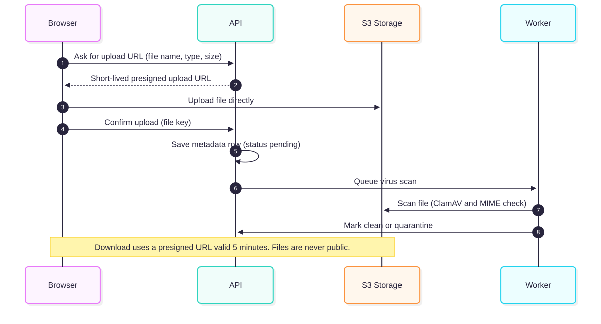

- Keys are namespaced: `org/{orgId}/suppliers/{supplierId}/{uuid}-{filename}`.
- The API **never** handles file bytes.
- Files can't be downloaded until the scan finishes.
- Rejected/expired files move to cheaper storage after 90 days.

### 4.9 Notifications


- Channels: in-app now (SSE later), email now, webhook/Slack/Teams later.
- User preferences stored per event type and channel.
- **No duplicates:** each notification has a deterministic key (`event_id + user_id + type`), so retries are safe.

### 4.10 Background processing

| Item        | Design                                                                                                                                                                                                               |
| ----------- | -------------------------------------------------------------------------------------------------------------------------------------------------------------------------------------------------------------------- |
| Tool        | **BullMQ on Redis**, workers run in a separate container                                                                                                                                                             |
| Reliability | Transactional **outbox**: no event lost between database commit and queue publish. Relay is idempotent and retries with exponential backoff.                                                                         |
| Jobs        | `send-notification`, `send-email`, `compute-supplier-performance` (nightly), `refresh-spend-materialized-views`, `scan-uploaded-document`, `generate-export`, `send-approval-reminders`, `expire-supplier-documents` |
| Failures    | Dead-letter queue, shown on an admin page                                                                                                                                                                            |
| Scheduling  | BullMQ repeatable jobs (no external cron)                                                                                                                                                                            |

### 4.11 Caching

| What                      | TTL / invalidation             | Why                                     |
| ------------------------- | ------------------------------ | --------------------------------------- |
| Sessions / refresh tokens | 30 days, on rotation           | Needed for revocation                   |
| User permission set       | 15 min, cleared on role change | Checked on every request                |
| Organization settings     | 1 hour, cleared on update      | Read often, changes rarely              |
| Dashboard aggregates      | 5 min                          | Expensive and fine to be slightly stale |
| Supplier list page 1      | 60 s                           | Very hot read                           |
| Rate-limit counters       | Sliding window                 | Needs atomic operations                 |

> 🚫 **Never cached:** approval instances, invoice/payment state, anything used in a write decision. **Financial correctness beats speed.**

### 4.12 Deployment & operations

| Topic         | Choice                                                                                                                                    |
| ------------- | ----------------------------------------------------------------------------------------------------------------------------------------- |
| Images        | Docker multi-stage: `web`, `api`, `worker`, `migrate` (one-shot)                                                                          |
| Run           | docker-compose locally; AWS ECS/Fargate (or VPS + Compose) in production. RDS, ElastiCache, S3.                                           |
| Proxy         | NGINX: TLS, rate limits, routes `/api/*` to API and the rest to Next.js                                                                   |
| CI/CD         | GitHub Actions: lint → typecheck → unit tests → integration tests (Testcontainers) → build → push → migrate → rolling deploy → smoke test |
| Migrations    | Expand/contract (add nullable column → backfill → enforce → drop old)                                                                     |
| Observability | pino JSON logs (with `trace_id`, `org_id`), Prometheus metrics, Sentry, `/health` and `/ready`                                            |

---

## 5. Critical Workflows (System Design Diagrams)

> Each workflow has: **a diagram → the story in plain words → rules → what can go wrong**.
> In sequence diagrams, read top to bottom; solid arrows are requests, dashed arrows are replies.

### 5.1 Workflow A — Supplier registration & verification

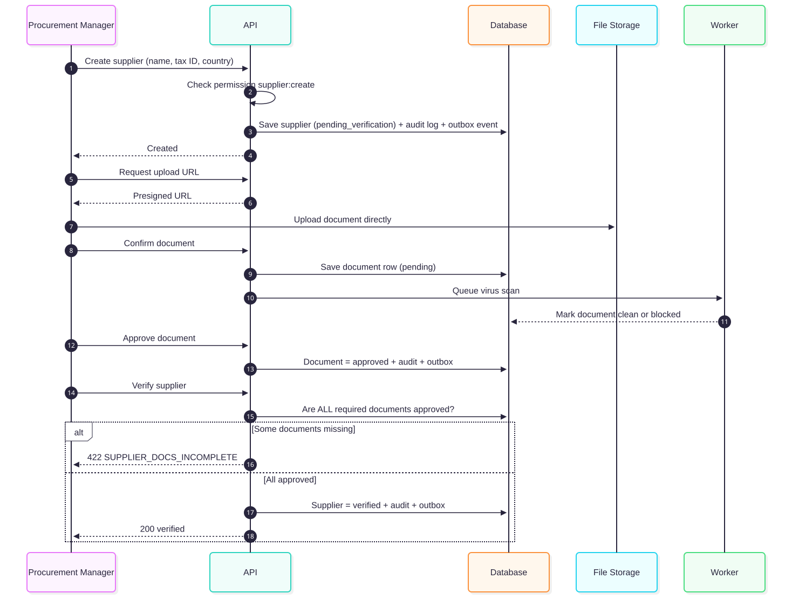

**In plain words**

1. Manager creates the supplier → it starts as `pending_verification`.
2. Documents go **straight to S3**; only a metadata row goes to the database.
3. A worker scans each file for viruses.
4. A reviewer approves each document, then clicks **Verify**, then **Activate**.

**Rules**

- `tax_id` is unique per company (no duplicate vendors).
- Allowed moves only: `pending → verified → active`, and any state → `suspended` / `blacklisted`.
- **Activate** needs: status `verified` + all required documents approved + none expired.
- BR-06 is re-checked when a PO is created. Never trust an older check.

**What can go wrong**

| Failure                           | What happens                                                                   |
| --------------------------------- | ------------------------------------------------------------------------------ |
| Upload fails                      | URL expires in 15 min, UI retries. No DB row exists yet, so no orphan data.    |
| File uploaded but never confirmed | Nightly job deletes S3 objects with no DB row after 24 h.                      |
| Two reviewers verify at once      | `SELECT … FOR UPDATE` on the supplier. The second gets `409 ALREADY_VERIFIED`. |
| Virus found                       | Document set to `blocked`; supplier can't be verified; security team notified. |

**Transactions:** every status change = state update + audit log + outbox event in **one** transaction.
**Notifications:** `SupplierCreated` → reviewers · `SupplierVerified` → creator · `SupplierRejected` → creator with reason.
**Bottleneck:** human review, not the system. Use a queue with SLA timers.

### 5.2 Workflow B — Purchase request & multi-level approval

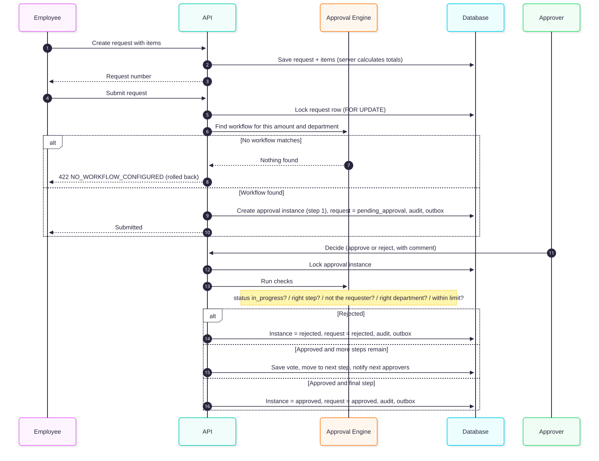

**In plain words**

1. The employee builds a request. The **server** calculates totals.
2. On submit, the engine picks the steps that match the **amount** and **department**.
3. Approvers are notified step by step.
4. Any rejection ends it. When the last step approves, the request is `approved`.

**Rules**

1. **Workflow resolution:** load the active workflow → keep steps where `min_amount ≤ total ≤ max_amount` (empty = unlimited) and the department condition matches → sort by `step_order`.
2. **Snapshot:** the chosen steps are copied into the instance, so later workflow edits don't change in-flight approvals.
3. **Who may approve:** has the role **and** scope matches **and** limit is enough **and** is not the requester.
4. **Parallel steps:** all eligible approvers must act. Any rejection fails the step; all approving passes it.
5. **Rejection is final.** Create a new request.

**What can go wrong**

| Failure                           | What happens                                                           |
| --------------------------------- | ---------------------------------------------------------------------- |
| Two approvers act at once         | Row lock. The second gets `409 STEP_ALREADY_COMPLETED`.                |
| Approver deactivated mid-approval | Reconciliation job reassigns to the role's next holder and notifies.   |
| No workflow for this amount       | Submission is blocked with a clear error (better than auto-approving). |
| Engine fails halfway              | Whole transaction rolls back; request stays `submitted`; retry.        |
| Requester approves own request    | `403 SEGREGATION_OF_DUTIES` (checked twice).                           |

**Notifications:** `PRSubmitted` → step-1 approvers · `StepAdvanced` → next approvers · `PRApproved` → requester + procurement · `PRRejected` → requester with comment · `ApprovalReminder` → after SLA hours.
**Bottleneck:** human response time. Use inbox bulk actions, reminders, delegation, out-of-office.

### 5.3 Workflow C — Purchase order generation

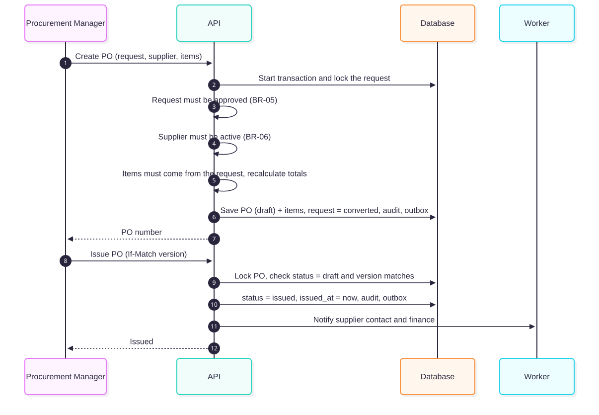

**In plain words**

1. A PO can only be made from an **approved** request, for an **active** supplier.
2. Everything happens in **one transaction** across about 6 tables. No PO without items, no "converted" request without a PO.
3. After creation the PO is a `draft`. A separate permission (`po:issue`) is needed to issue it.

**Rules**

- `po_number` comes from a per-company counter, incremented inside the same transaction.
- Items are **copied** from the request (prices may be renegotiated). The link back is kept in `purchase_request_item_id`.
- Totals are always recalculated on the server.
- The PO has a `version`. `If-Match` stops two managers issuing and cancelling at the same time.
- Direct POs (no request) are a future feature behind a policy flag.

**What can go wrong**

| Failure                                   | What happens                                                |
| ----------------------------------------- | ----------------------------------------------------------- |
| Request already converted                 | Lock + status check → `409 REQUEST_ALREADY_CONVERTED`       |
| Supplier suspended before issue           | `422 SUPPLIER_NOT_ACTIVE`; PO stays draft                   |
| Quantity higher than the approved request | Validation error. Over-ordering needs a new request.        |
| Number collision                          | Counter update and insert are in one transaction (row lock) |
| Notification fails after commit           | Outbox retries. The PO exists regardless.                   |

**Notifications:** `PurchaseOrderCreated` → procurement · `PurchaseOrderIssued` → supplier + finance · `PurchaseOrderCancelled` → everyone involved.
**Bottleneck:** PDF generation, which runs in a worker.

### 5.4 Workflow D — Invoice verification & payment

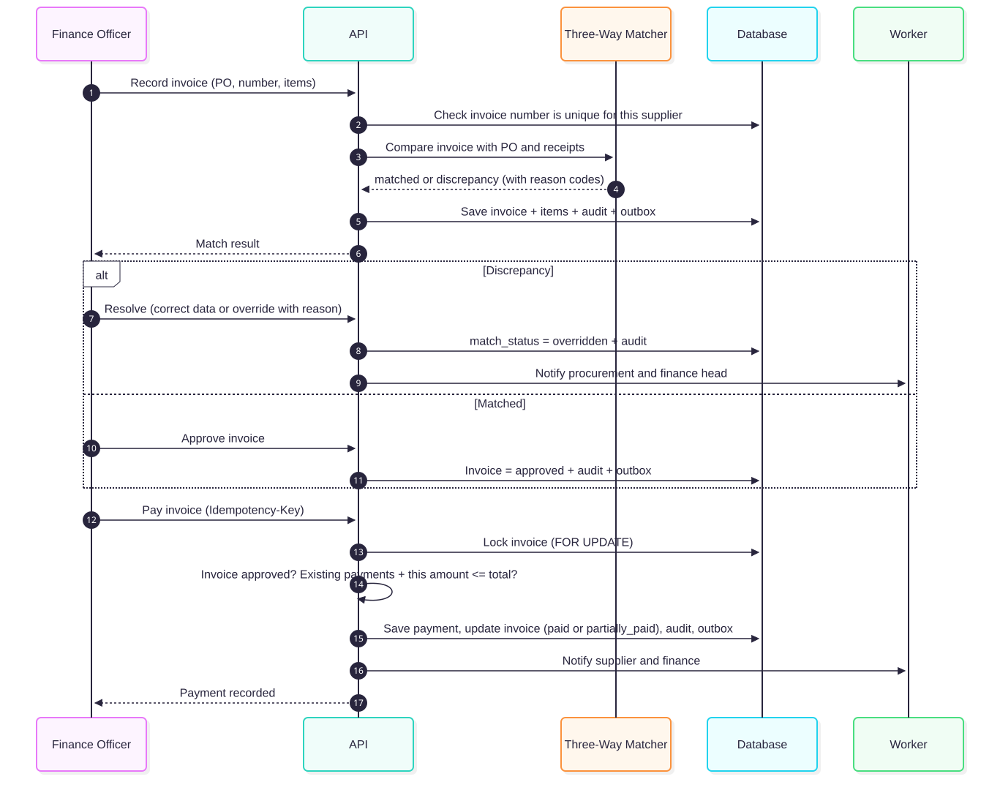

**The three-way match — what is compared**


| Check        | Rule                                                               | Failure code                  |
| ------------ | ------------------------------------------------------------------ | ----------------------------- |
| Quantity     | Invoice qty ≤ received qty (can't bill for goods not received)     | `QTY_MISMATCH` / `NO_RECEIPT` |
| Unit price   | Difference within tolerance (default **2%**, configurable)         | `PRICE_MISMATCH`              |
| Total        | Difference within absolute tolerance (default 0, plus the % above) | `PRICE_MISMATCH`              |
| Line mapping | Every invoice line maps to a PO item                               | `UNMATCHED_LINE`              |
| Duplicate    | `(org, supplier, invoice_number)` is unique                        | `DUPLICATE_INVOICE`           |

**Payment rules**

1. Only against an `approved` invoice (BR-08).
2. `processing` + `completed` payments can never exceed the invoice total. Enforced by a row lock **and** a database trigger (last line of defence).
3. **Idempotency:** the `Idempotency-Key` is stored in Redis with the payment ID. A retry returns the same result, never a second payment.
4. Partial payments set the invoice to `partially_paid`.

**Who can do what:** `invoice:create` (Finance) · `invoice:override` (Finance, **written reason required**, always flagged in audit) · `invoice:approve` (Finance, and **not** the person who recorded it) · `payment:create` (Finance, **MFA required**).

**What can go wrong**

| Failure                             | What happens                                                                        |
| ----------------------------------- | ----------------------------------------------------------------------------------- |
| Duplicate invoice number            | `409 DUPLICATE_INVOICE` from the unique constraint                                  |
| Invoice for a cancelled PO          | `422 PO_NOT_ISSUED`                                                                 |
| Payment retried after timeout       | Idempotency key returns the original payment                                        |
| Two officers pay at once            | Row lock. The second sees the new sum and is rejected if it would exceed the total. |
| Matcher crashes                     | Whole transaction rolls back. Retry.                                                |
| Bank transfer fails after recording | Payment = `failed`; invoice returns to `approved`; reconciliation job flags it      |

**Notifications:** `InvoiceRecorded` → finance · `InvoiceDiscrepancyDetected` → finance + procurement · `InvoiceApproved` → supplier + AP · `PaymentRecorded` → supplier + finance + requester.
**Bottleneck:** none now. At scale, matching can move to a worker (`match_status = 'pending'`). For payments: **correctness over speed, always.**

### 5.5 Bottleneck cheat-sheet (all workflows)

| Bottleneck           | Symptom                    | Fix                                                                     |
| -------------------- | -------------------------- | ----------------------------------------------------------------------- |
| Approval inbox query | Slow "pending my approval" | Index `(org, status, current_step_order)`, per-approver queue if needed |
| Analytics dashboards | Slow loads over time       | Read replica + pre-computed aggregates + 5-min cache                    |
| Audit log growth     | Slow document history      | Monthly partitions + `(org, entity_type, entity_id, created_at)` index  |
| Notification storms  | Email provider throttling  | Batching, digest mode, rate-limited queue                               |
| File uploads         | API bandwidth              | Presigned direct-to-S3 uploads                                          |
| Noisy neighbour      | One company starves others | Per-tenant rate limits and statement timeouts                           |
| Long reports         | Blocks API workers         | Run in a worker, deliver a download link                                |

---

## 6. API Structure

### 6.1 Rules for every endpoint

| Topic                  | Rule                                                                                                                                     |
| ---------------------- | ---------------------------------------------------------------------------------------------------------------------------------------- |
| Base path              | `/api/v1` (breaking changes → `/api/v2`)                                                                                                 |
| Authentication         | Cookie-based JWT. Required everywhere except `/auth/login`, `/auth/refresh`, `/health`.                                                  |
| Tenant                 | Taken from the token. **Never** from the URL or body. Any `organizationId` in a payload is ignored.                                      |
| Format                 | JSON. Files use presigned URLs, not multipart uploads.                                                                                   |
| Pagination             | **Cursor-based**: `?limit=50&cursor=<opaque>` → `{ data: [...], page: { nextCursor, hasMore } }` (offset paging gets slow on big tables) |
| Filtering / sorting    | Allow-listed query params, e.g. `?status=active&sort=-created_at`                                                                        |
| Idempotency            | `Idempotency-Key` header **required** on `POST /payments` and `POST /purchase-orders`                                                    |
| Lost-update protection | `If-Match: <version>` on all status transitions. `409` on mismatch.                                                                      |
| Docs                   | OpenAPI 3 generated from NestJS decorators, at `/api/docs` (non-production)                                                              |

**HTTP status codes**

| Code            | Meaning                                                                          |
| --------------- | -------------------------------------------------------------------------------- |
| 200 / 201 / 204 | OK / Created / No content                                                        |
| 400             | Validation error                                                                 |
| 401             | Not logged in                                                                    |
| 403             | Not allowed                                                                      |
| 404             | Not found (**also** used for other companies' records, so existence never leaks) |
| 409             | State conflict (someone else changed it first)                                   |
| 422             | Business rule violated                                                           |
| 429             | Rate limited                                                                     |
| 500             | Server error                                                                     |

**Standard error format**

```json
{
  "error": {
    "code": "SUPPLIER_NOT_ACTIVE",
    "message": "Supplier must be active to issue a purchase order.",
    "details": {},
    "traceId": "..."
  }
}
```

### 6.2 Endpoint map

**🔑 Auth**

| Method | Path                                    | Purpose                                           |
| ------ | --------------------------------------- | ------------------------------------------------- |
| POST   | `/auth/login`                           | Log in                                            |
| POST   | `/auth/refresh`                         | Get a new access token                            |
| POST   | `/auth/logout`                          | Log out                                           |
| POST   | `/auth/mfa/enroll` · `/auth/mfa/verify` | Set up / check MFA                                |
| GET    | `/auth/me`                              | Current user + roles + permissions + org settings |

**🏢 Organization & Identity**

| Method         | Path                                   | Purpose                         |
| -------------- | -------------------------------------- | ------------------------------- |
| GET · PATCH    | `/organization`                        | View / update company profile   |
| GET · PATCH    | `/organization/settings`               | View / update settings          |
| GET · POST     | `/departments` (`?parentId=&status=`)  | List / create departments       |
| PATCH · DELETE | `/departments/:id`                     | Update / archive (soft delete)  |
| GET            | `/users` (`?status=&departmentId=&q=`) | List users                      |
| POST           | `/users/invite`                        | Invite a user                   |
| PATCH          | `/users/:id`                           | Update a user                   |
| POST           | `/users/:id/deactivate`                | Deactivate a user               |
| GET            | `/users/:id/permissions`               | Effective permissions           |
| GET · POST     | `/roles`                               | List / create roles             |
| PATCH · DELETE | `/roles/:id`                           | Update / delete a role          |
| GET            | `/permissions`                         | Permission catalogue            |
| PUT            | `/roles/:id/permissions`               | Replace a role's permission set |
| PUT            | `/users/:id/roles`                     | Replace a user's roles          |

**🏭 Suppliers**

| Method      | Path                                                      | Purpose                  |
| ----------- | --------------------------------------------------------- | ------------------------ |
| GET · POST  | `/suppliers` (`?status=&categoryId=&country=&q=&cursor=`) | List / create            |
| GET · PATCH | `/suppliers/:id`                                          | View / update            |
| POST        | `/suppliers/:id/verify`                                   | Mark verified            |
| POST        | `/suppliers/:id/activate`                                 | Activate                 |
| POST        | `/suppliers/:id/suspend`                                  | Suspend                  |
| POST        | `/suppliers/:id/blacklist`                                | Blacklist                |
| GET · POST  | `/suppliers/:id/documents`                                | List / add document      |
| POST        | `/suppliers/:id/documents/presign`                        | Get upload URL           |
| POST        | `/suppliers/:id/documents/:docId/approve` · `/reject`     | Review a document        |
| GET         | `/suppliers/:id/performance` (`?from=&to=`)               | Performance history      |
| GET · POST  | `/supplier-categories`                                    | List / create categories |

**📝 Purchase Requests**

| Method     | Path                                                                           | Purpose             |
| ---------- | ------------------------------------------------------------------------------ | ------------------- |
| GET · POST | `/purchase-requests` (`?status=&departmentId=&requesterId=&from=&to=&cursor=`) | List / create       |
| GET        | `/purchase-requests/:id`                                                       | View                |
| PATCH      | `/purchase-requests/:id`                                                       | Edit (draft only)   |
| POST       | `/purchase-requests/:id/submit`                                                | Submit for approval |
| POST       | `/purchase-requests/:id/cancel`                                                | Cancel              |
| GET        | `/purchase-requests/:id/approval`                                              | Approval timeline   |
| GET        | `/purchase-requests/:id/attachments`                                           | List attachments    |
| POST       | `/purchase-requests/:id/attachments/presign`                                   | Get upload URL      |

**✅ Approvals**

| Method     | Path                                                     | Purpose                      |
| ---------- | -------------------------------------------------------- | ---------------------------- |
| GET        | `/approvals/pending` (`?entityType=`)                    | My inbox                     |
| GET        | `/approvals/history`                                     | My past decisions            |
| GET        | `/approvals/:instanceId`                                 | View one approval            |
| POST       | `/approvals/:instanceId/decide` `{ decision, comment }`  | Approve or reject            |
| POST       | `/approvals/:instanceId/delegate` `{ toUserId, reason }` | Hand over to someone         |
| GET · POST | `/approval-workflows` (`?entityType=`)                   | List / create workflows      |
| GET        | `/approval-workflows/:id`                                | View                         |
| PUT        | `/approval-workflows/:id`                                | Edit (creates a new version) |
| POST       | `/approval-workflows/:id/activate` · `/deactivate`       | Switch on / off              |

**📄 Purchase Orders**

| Method      | Path                                                                     | Purpose                                     |
| ----------- | ------------------------------------------------------------------------ | ------------------------------------------- |
| GET         | `/purchase-orders` (`?status=&supplierId=&departmentId=&from=&to=`)      | List                                        |
| POST        | `/purchase-orders`                                                       | Create from a request (**Idempotency-Key**) |
| GET · PATCH | `/purchase-orders/:id`                                                   | View / edit (draft only)                    |
| POST        | `/purchase-orders/:id/issue`                                             | Issue to supplier                           |
| POST        | `/purchase-orders/:id/acknowledge`                                       | Supplier acknowledged                       |
| POST        | `/purchase-orders/:id/receipts` `{ items: [{ poItemId, receivedQty }] }` | Record goods received                       |
| POST        | `/purchase-orders/:id/cancel`                                            | Cancel                                      |
| GET         | `/purchase-orders/:id/pdf`                                               | Download PDF                                |

**🧾 Invoices & 💳 Payments**

| Method     | Path                                                                      | Purpose                                       |
| ---------- | ------------------------------------------------------------------------- | --------------------------------------------- |
| GET · POST | `/invoices` (`?status=&supplierId=&poId=&matchStatus=`)                   | List / record                                 |
| GET        | `/invoices/:id`                                                           | View                                          |
| POST       | `/invoices/:id/rematch`                                                   | Re-run the three-way match                    |
| POST       | `/invoices/:id/resolve` `{ action: correct or override, reason, items? }` | Fix a discrepancy                             |
| POST       | `/invoices/:id/approve` · `/reject`                                       | Decide                                        |
| GET        | `/invoices/:id/attachments`                                               | Attachments                                   |
| GET        | `/payments` (`?invoiceId=&status=&from=&to=`)                             | List payments                                 |
| POST       | `/payments`                                                               | Record payment (**Idempotency-Key required**) |
| GET        | `/payments/:id`                                                           | View                                          |
| POST       | `/payments/:id/reverse` `{ reason }`                                      | Reverse                                       |

**📊 Analytics**

| Method | Path                                                               | Purpose                             |
| ------ | ------------------------------------------------------------------ | ----------------------------------- |
| GET    | `/analytics/spend/summary` (`?from=&to=&groupBy=month`)            | Spend summary                       |
| GET    | `/analytics/spend/by-department` · `/by-supplier` · `/by-category` | Spend breakdowns                    |
| GET    | `/analytics/requests/pending`                                      | Pending requests                    |
| GET    | `/analytics/approvals/cycle-time`                                  | Approval speed                      |
| GET    | `/analytics/suppliers/performance-trends`                          | Supplier trends                     |
| GET    | `/analytics/export/:report`                                        | Start an export (returns a `jobId`) |
| GET    | `/analytics/jobs/:jobId`                                           | Check export status                 |

**🔔 Support**

| Method | Path                                                        | Purpose       |
| ------ | ----------------------------------------------------------- | ------------- |
| GET    | `/notifications` (`?unreadOnly=true&cursor=`)               | List          |
| POST   | `/notifications/:id/read` · `/notifications/read-all`       | Mark as read  |
| GET    | `/audit-logs` (`?entityType=&entityId=&actorId=&from=&to=`) | Audit trail   |
| GET    | `/health` · `/ready`                                        | Health probes |

### 6.3 Example request and responses

```http
POST /api/v1/purchase-requests/8f2c.../submit
Cookie: access_token=...
```

**Success — 200 OK**

```json
{
  "data": {
    "id": "8f2c...",
    "requestNumber": "PR-2026-000418",
    "status": "pending_approval",
    "approval": {
      "instanceId": "a91b...",
      "currentStep": 1,
      "totalSteps": 2,
      "awaiting": [{ "role": "Department Manager", "userId": "d3e4..." }]
    }
  }
}
```

**Error — 422 Unprocessable Entity** (returned, for example, when someone tries to approve their own request)

```json
{
  "error": {
    "code": "SEGREGATION_OF_DUTIES",
    "message": "You cannot approve a request you created.",
    "details": { "requesterId": "d3e4...", "approverId": "d3e4..." },
    "traceId": "01HQ..."
  }
}
```

---

## 7. Architecture Decision Records (ADRs)

> Each ADR answers the same five questions: **Problem → Options → Decision → Why → Trade-off.**

### ADR index

| ADR | Decision                                                     |
| --- | ------------------------------------------------------------ |
| 001 | PostgreSQL as the primary datastore                          |
| 002 | Drizzle ORM instead of Prisma                                |
| 003 | Modular monolith instead of microservices                    |
| 004 | Redis, used only for four specific jobs                      |
| 005 | Multi-tenancy: shared schema + Row-Level Security            |
| 006 | Approval workflows stored as data, not code                  |
| 007 | Invoice/PO consistency: snapshot + three-way match + locks   |
| 008 | Reliable background jobs: transactional outbox + BullMQ      |
| 009 | JWT access tokens + rotating refresh tokens + Redis denylist |
| 010 | Audit log: append-only table written inside the transaction  |

---

### ADR-001 — PostgreSQL

|               |                                                                                                                                                                                                                                                 |
| ------------- | ----------------------------------------------------------------------------------------------------------------------------------------------------------------------------------------------------------------------------------------------- |
| **Problem**   | The core is a chain of financial documents that need referential and transactional integrity.                                                                                                                                                   |
| **Options**   | MongoDB, MySQL, DynamoDB, SQL Server                                                                                                                                                                                                            |
| **Decision**  | **PostgreSQL 16**                                                                                                                                                                                                                               |
| **Why**       | The domain is relational. Foreign keys enforce "no invoice without a PO". ACID transactions make PO creation + item copy + request update + audit log all-or-nothing. `NUMERIC` gives exact money math. RLS, JSONB and partitioning are native. |
| **Pros**      | Strongest correctness for financial data; one engine for transactions, config, isolation; large talent pool; managed hosting (RDS).                                                                                                             |
| **Cons**      | Single-primary scaling ceiling; migrations need discipline; heavier than a document store for schema-less data.                                                                                                                                 |
| **Trade-off** | We accept migration effort and read-replica lag in return for correctness. If analytics ever outgrows Postgres, extract it to a warehouse. The transactional core stays relational.                                                             |

### ADR-002 — Drizzle ORM

|               |                                                                                                                                                                                              |
| ------------- | -------------------------------------------------------------------------------------------------------------------------------------------------------------------------------------------- |
| **Problem**   | We need type-safe DB access that does not hide the SQL.                                                                                                                                      |
| **Options**   | Prisma, TypeORM, Knex, raw `pg`                                                                                                                                                              |
| **Decision**  | **Drizzle ORM**                                                                                                                                                                              |
| **Why**       | What you write is what runs. We depend on specific composite indexes and `FOR UPDATE` locks, so we must control query plans. Schema is TypeScript, so types and migrations share one source. |
| **Pros**      | Predictable SQL, tiny runtime, first-class TS inference, raw-SQL escape hatch for the three-way-match query.                                                                                 |
| **Cons**      | Smaller ecosystem; no built-in soft delete; more manual work for complex relations.                                                                                                          |
| **Trade-off** | We give up Prisma's ergonomics for SQL transparency. For a system where a missing index or N+1 is a real incident, that is the right trade.                                                  |

### ADR-003 — Modular monolith

|               |                                                                                                                                                                                                                                                                          |
| ------------- | ------------------------------------------------------------------------------------------------------------------------------------------------------------------------------------------------------------------------------------------------------------------------ |
| **Problem**   | Pick a deployment shape for tightly coupled financial rules and a small team.                                                                                                                                                                                            |
| **Options**   | Microservices, SOA/ESB, modular monolith, unstructured monolith                                                                                                                                                                                                          |
| **Decision**  | **Modular monolith**                                                                                                                                                                                                                                                     |
| **Why**       | Creating a PO crosses requests, approvals, orders, audit and notifications. In microservices that needs sagas and compensating actions (eventual consistency on money). A monolith gives one transaction and one deployment; module boundaries keep extraction possible. |
| **Pros**      | Atomic transactions, simple debugging, low ops cost, fast iteration, enforced design discipline.                                                                                                                                                                         |
| **Cons**      | Modules scale together; one module's memory leak affects all; one pipeline is shared.                                                                                                                                                                                    |
| **Trade-off** | Coupled scaling in exchange for correctness and speed. A module accessed only through its published interface can later become a service.                                                                                                                                |

### ADR-004 — Redis (exactly where it is needed)

|               |                                                                                                                                                                                                              |
| ------------- | ------------------------------------------------------------------------------------------------------------------------------------------------------------------------------------------------------------ |
| **Problem**   | Is Redis needed, and for what?                                                                                                                                                                               |
| **Options**   | No cache, Redis for everything, in-process cache only                                                                                                                                                        |
| **Decision**  | **Yes, for four jobs only:** (1) sessions/refresh tokens with revocation, (2) BullMQ queues, (3) short-TTL caches (permissions, org settings, dashboards), (4) rate limits and idempotency keys              |
| **Why**       | Revocation lists must be shared across API instances. Durable retryable queues need Redis (BullMQ).                                                                                                          |
| **Pros**      | Sub-millisecond reads, shared state, mature queue tooling, atomic counters.                                                                                                                                  |
| **Cons**      | One more stateful service; memory is costly; cache invalidation bugs are subtle.                                                                                                                             |
| **Trade-off** | We **never cache the money path** (approvals, invoice state, payment sums). Redis is never a source of truth. If lost: sessions reset and jobs replay from the outbox, which is annoying but not corrupting. |

### ADR-005 — Shared schema + Row-Level Security

|               |                                                                                                                                                                                                       |
| ------------- | ----------------------------------------------------------------------------------------------------------------------------------------------------------------------------------------------------- |
| **Problem**   | Isolate many companies' data without per-tenant operations overhead.                                                                                                                                  |
| **Options**   | Database per tenant, schema per tenant, shared schema with app-only filtering, shared schema with RLS                                                                                                 |
| **Decision**  | **Shared DB, shared schema, `organization_id` everywhere, plus RLS**                                                                                                                                  |
| **Why**       | App-only filtering fails on one forgotten `WHERE`. With RLS, that bug becomes an error instead of a leak. One migration run regardless of tenant count.                                               |
| **Pros**      | Defence in depth, cheap, one migration path, easy platform reporting.                                                                                                                                 |
| **Cons**      | Noisy-neighbour risk; a bad RLS policy is catastrophic; some enterprises want physical isolation.                                                                                                     |
| **Trade-off** | Mitigated with `SET LOCAL` per transaction, a non-`BYPASSRLS` role, per-tenant rate limits and automated cross-tenant tests that expect 404. Physical isolation is offered as a dedicated deployment. |

### ADR-006 — Workflows as data

|               |                                                                                                                                                                                                     |
| ------------- | --------------------------------------------------------------------------------------------------------------------------------------------------------------------------------------------------- |
| **Problem**   | Every company has different, changing purchase policies.                                                                                                                                            |
| **Options**   | Hard-coded `if (amount > 5000)`, full BPMN engine (Camunda/Temporal), data-driven tables                                                                                                            |
| **Decision**  | **Data-driven:** `approval_workflows` + `approval_workflow_steps`, resolved at submission into `approval_instances` + `approval_actions`                                                            |
| **Why**       | Hard-coding means a release for every policy change. BPMN is overkill for "ordered steps filtered by amount and department".                                                                        |
| **Pros**      | Policy change = database row, not a deploy. Fully auditable (we know which version approved what). Simple, testable, no external engine.                                                            |
| **Cons**      | Can't express arbitrary graphs or complex parallel branches.                                                                                                                                        |
| **Trade-off** | Less expressive but simpler. Escape hatch: `condition_json`, and a future move to a real engine if a customer needs it. Instances snapshot their steps, so edits never corrupt in-flight approvals. |

### ADR-007 — Layers of protection for money

|               |                                                                                                                                                                                                                                                |
| ------------- | ---------------------------------------------------------------------------------------------------------------------------------------------------------------------------------------------------------------------------------------------- |
| **Problem**   | Guarantee payments never exceed what was ordered and received, and that two officers can't double-pay.                                                                                                                                         |
| **Options**   | Trust the UI, periodic reconciliation only, app-only checks, database enforcement                                                                                                                                                              |
| **Decision**  | **Five layers:** (1) PO items snapshotted from the request, (2) three-way match with tolerances, (3) `SELECT … FOR UPDATE` on the invoice, (4) DB trigger `SUM(active payments) ≤ invoice.total`, (5) unique `(org, supplier, invoice_number)` |
| **Why**       | Each layer catches a different bug class: the app gives good messages, the lock handles concurrency, the trigger catches service-layer regressions.                                                                                            |
| **Pros**      | Cannot double-pay even under concurrency or a code bug. Every discrepancy has a reason code. Full audit trail.                                                                                                                                 |
| **Cons**      | More complex; triggers are harder to debug; strict rules can frustrate users.                                                                                                                                                                  |
| **Trade-off** | Some friction (manual override with a written reason) in exchange for safety. Overrides are always audited and notify a second person.                                                                                                         |

### ADR-008 — Outbox + BullMQ

|               |                                                                                                                                                                                                       |
| ------------- | ----------------------------------------------------------------------------------------------------------------------------------------------------------------------------------------------------- |
| **Problem**   | Emails, scores and exports must not block requests, and must not be lost if the process crashes between DB commit and queue publish.                                                                  |
| **Options**   | Fire-and-forget async, `queue.add()` after commit, DB polling only, Kafka                                                                                                                             |
| **Decision**  | **Transactional outbox + BullMQ workers**                                                                                                                                                             |
| **Why**       | This avoids the "dual-write" problem. The event row is written in the **same transaction** as the change, so it exists if and only if the change does. A relay publishes to BullMQ and marks it done. |
| **Pros**      | No lost events, no distributed transaction, retries with backoff, dead-letter queue.                                                                                                                  |
| **Cons**      | Slight delay (poll interval, usually under 1 s); consumers must be idempotent; one more table.                                                                                                        |
| **Trade-off** | We accept **at-least-once** delivery and build idempotency, instead of chasing impossible exactly-once. Kafka is not justified at this volume.                                                        |

### ADR-009 — JWT + rotating refresh tokens

|               |                                                                                                                                                                                          |
| ------------- | ---------------------------------------------------------------------------------------------------------------------------------------------------------------------------------------- |
| **Problem**   | Authenticate across stateless instances while allowing instant revocation (deactivated employee, stolen laptop).                                                                         |
| **Options**   | Server sessions only, long-lived JWT, short JWT with no revocation, external IdP                                                                                                         |
| **Decision**  | **15-min RS256 JWT + opaque rotating refresh token (30-day sliding) in Redis, with reuse detection and a `session_id` denylist**                                                         |
| **Why**       | Long JWTs can't be revoked. Server sessions need a lookup on every request. The hybrid is stateless in the common case. Replay of an old refresh token revokes the whole session family. |
| **Pros**      | Scales horizontally, short compromise window, instant revocation, XSS-resistant cookies.                                                                                                 |
| **Cons**      | Two tokens to manage; clock-skew sensitivity; Redis on the auth path.                                                                                                                    |
| **Trade-off** | Extra moving parts, because "deactivate this employee now" is a hard requirement. SSO is layered on later, not a replacement.                                                            |

### ADR-010 — Append-only audit log in the transaction

|               |                                                                                                                                                                                                                             |
| ------------- | --------------------------------------------------------------------------------------------------------------------------------------------------------------------------------------------------------------------------- |
| **Problem**   | Procurement needs a complete, tamper-evident history without losing entries or slowing the system.                                                                                                                          |
| **Options**   | App logs (ELK), DB triggers, external audit service, append-only table written by the app                                                                                                                                   |
| **Decision**  | **Append-only `audit_logs`, written inside the same transaction, with `before_state` / `after_state` JSON.** App role has INSERT and SELECT only.                                                                           |
| **Why**       | Outside the transaction, a rollback leaves phantom entries and a crash leaves missing ones. Inside, the log is exactly as durable as the change. No UPDATE/DELETE grant means even a compromised app can't rewrite history. |
| **Pros**      | Perfect consistency with business state, tamper-resistant, rich context, simple.                                                                                                                                            |
| **Cons**      | Extra write on every change; table grows fast; JSON isn't joinable.                                                                                                                                                         |
| **Trade-off** | Storage cost, reduced with monthly partitioning and cold archiving. Audit data is read, not aggregated. A hash chain (each row hashes the previous) is a documented future upgrade.                                         |

---

## 8. MVP vs Future Scope

### 8.1 Scope boundary

| Capability                                       |   MVP    |   Phase 2   | Phase 3+ |
| ------------------------------------------------ | :------: | :---------: | :------: |
| Multi-tenancy + RLS                              |    ✅    |             |          |
| RBAC + custom roles                              |    ✅    |             |          |
| Department hierarchy                             |    ✅    |             |          |
| Supplier CRUD + documents + verification         |    ✅    |             |          |
| Supplier self-service portal                     |          |     ✅      |          |
| Supplier risk scoring (rules-based)              | ✅ basic |             |          |
| Supplier risk scoring (ML)                       |          |             |    ✅    |
| Purchase requests + line items                   |    ✅    |             |          |
| Configurable approvals (sequential, amount/role) |    ✅    |             |          |
| Parallel / conditional approval branches         |          |     ✅      |          |
| Delegation & out-of-office                       |          |     ✅      |          |
| Purchase orders + receipts                       |    ✅    |             |          |
| Invoice recording + three-way match              |    ✅    |             |          |
| Payments                                         |    ✅    |             |          |
| Multi-currency + FX                              |          |             |    ✅    |
| Contracts                                        |          |     ✅      |          |
| Budget envelopes                                 |          |     ✅      |          |
| Analytics dashboards                             | ✅ core  | ✅ advanced |    ✅    |
| Audit log                                        |    ✅    |             |          |
| Notifications (in-app + email)                   |    ✅    |             |          |
| Webhooks / Slack / Teams                         |          |     ✅      |          |
| SSO / SAML                                       |          |     ✅      |          |
| ERP / accounting integrations                    |          |             |    ✅    |
| Mobile app                                       |          |             |    ✅    |
| e-auctions / RFQ                                 |          |             |    ✅    |

### 8.2 Why these are in the MVP

- **Suppliers → requests → approvals → POs → invoices → payments:** this _is_ the chain. Remove one and there is only a list, not a product.
- **Configurable approvals (not hard-coded):** different companies have different policies. Fixed thresholds would fail the first customer conversation.
- **Audit log:** procurement is a compliance function. An un-auditable system is unsellable.
- **Basic analytics:** "Where is our money going?" is the first executive question.
- **Basic supplier intelligence:** on-time rate and discrepancy rate are cheap to compute from existing data and make the product feel smart from day one.

### 8.3 Why these are postponed

| Postponed          | Reason                                                                                                                           |
| ------------------ | -------------------------------------------------------------------------------------------------------------------------------- |
| Supplier portal    | Needs a second login model (external users) and a separate permission universe. The MVP works with staff entering supplier data. |
| Contracts          | A big module on its own (versions, renewals, e-signature). Not needed to prove the chain.                                        |
| Budgets            | Needs a financial planning model (fiscal years, envelopes, commitments). A separate product surface.                             |
| Multi-currency     | FX rates, rate locking, reporting conversion. One currency per company is fine for early customers.                              |
| ERP integrations   | Each connector is a custom project with a long sales cycle. Export + API is enough for now.                                      |
| ML risk prediction | Needs historical data and labelled outcomes we don't have yet. Rules are honest and explainable.                                 |
| Mobile app         | Procurement is a desk activity. Responsive web covers it.                                                                        |

---

## 9. Risk and Scalability Analysis

### 9.1 Risk register

**How to read:** 🔴 Critical/High · 🟠 Medium · 🟢 Low

| ID   | Risk                                                       |     Likelihood      |   Impact    | Mitigation                                                                                                                  |
| ---- | ---------------------------------------------------------- | :-----------------: | :---------: | --------------------------------------------------------------------------------------------------------------------------- |
| R-01 | **Cross-tenant data leak** (missing filter)                |       🟢 Low        | 🔴 Critical | RLS in the DB; tenant never from user input; integration tests expecting 404; review rule for raw queries                   |
| R-02 | **Financial inconsistency** (double payment, over-receipt) |       🟢 Low        | 🔴 Critical | Row locks, triggers, unique constraints, idempotency keys, nightly reconciliation                                           |
| R-03 | **Bad approval workflow** blocks all purchases             |      🟠 Medium      |   🔴 High   | Validate on save (no gaps in amount bands); dry-run preview ("who approves $3,000?"); at least one active workflow enforced |
| R-04 | **Audit log growth** slows queries                         | 🔴 High (over time) |  🟠 Medium  | Monthly partitions, archiving, indexes on recent data                                                                       |
| R-05 | **Approval bottleneck** (people are slow)                  |       🔴 High       |  🟠 Medium  | Reminders, escalation after SLA, delegation, bulk approve, mobile-friendly inbox                                            |
| R-06 | **Supplier fraud** (fake supplier, duplicate bank details) |      🟠 Medium      |   🔴 High   | Mandatory document verification; duplicate tax-ID detection; bank-detail changes need dual approval + audit                 |
| R-07 | **Document storage cost / leak**                           |      🟠 Medium      |  🟠 Medium  | Private buckets, short-lived URLs, lifecycle policies, virus scanning                                                       |
| R-08 | **Noisy-neighbour tenant**                                 |      🟠 Medium      |  🟠 Medium  | Per-tenant rate limits, statement timeouts, per-tenant monitoring                                                           |
| R-09 | **Cloud vendor lock-in (AWS)**                             |      🟠 Medium      |  🟠 Medium  | S3-compatible abstraction; Postgres/Redis are portable; containers run anywhere                                             |
| R-10 | **Failed production migration**                            |      🟠 Medium      |   🔴 High   | Expand/contract; migrations as a separate job; test on a production-size snapshot                                           |
| R-11 | **Key-person dependency** on the approval engine           |      🟠 Medium      |  🟠 Medium  | Heavy unit tests, ADR documentation, workflow simulator                                                                     |
| R-12 | **Data-residency regulation**                              |    🟢 Low (now)     |   🔴 High   | Documented path to region-pinned deployments; per-tenant data export                                                        |

### 9.2 Scalability by layer


| Layer                | Approach                                                                                                                                                       |
| -------------------- | -------------------------------------------------------------------------------------------------------------------------------------------------------------- |
| **API**              | Holds no session state, so scaling = "add another container".                                                                                                  |
| **Database reads**   | Replica for analytics; primary handles writes and transactional reads.                                                                                         |
| **Database writes**  | Dominated by approval decisions and state changes: low volume, high value. Postgres handles thousands of writes/sec.                                           |
| **Database growth**  | Audit logs and notifications partitioned monthly and archived. Every index starts with `organization_id`, so per-tenant cost stays flat as tenant count grows. |
| **Database ceiling** | A single primary (about tens of thousands of orgs at this write profile). Next step: shard by `organization_id` (the schema is already tenant-keyed).          |
| **Caching**          | Redis for permissions, settings, dashboards. Target hit rate above 90%.                                                                                        |
| **Workers**          | Scale independently, auto-scale on queue depth.                                                                                                                |
| **Files**            | S3 is effectively unlimited; the API only issues URLs.                                                                                                         |
| **Frontend**         | Static/ISR assets on a CDN; small payloads thanks to Server Components.                                                                                        |
| **Deployment**       | Docker on ECS/Fargate or VPS + Compose, NGINX, GitHub Actions with rolling or blue/green deploys gated by health checks.                                       |

### 9.3 Fault tolerance

| Mechanism                    | Protects against                                                                                                        |
| ---------------------------- | ----------------------------------------------------------------------------------------------------------------------- |
| Outbox + retry               | Notification/aggregation failures blocking business transactions                                                        |
| Idempotency keys             | Double payment or double PO on retry                                                                                    |
| Circuit breakers (S3, email) | Provider outages (degrade to "queued", not "error")                                                                     |
| Health and readiness probes  | Bad instances staying in rotation                                                                                       |
| Graceful shutdown            | Lost in-flight requests and jobs                                                                                        |
| Backups                      | Postgres point-in-time recovery (WAL), daily snapshots, quarterly restore drills. Redis is disposable. S3 is versioned. |

### 9.4 Security posture

- TLS everywhere, HSTS, secure cookies, CSRF protection on cookie-authenticated writes.
- Argon2id passwords, MFA for privileged roles, login rate limits and lockout.
- Input validation on every DTO (class-validator / Zod). Parameterised queries only.
- Least-privilege DB roles: no `UPDATE`/`DELETE` on audit logs, no `BYPASSRLS`.
- Secrets in AWS Secrets Manager / injected environment, never in the repo.
- Dependency and container image scanning in CI.
- OWASP Top 10 addressed. Annual penetration test before enterprise launch.

### 9.5 Testing strategy

| Level              | What it covers                                                                     | Tooling               |
| ------------------ | ---------------------------------------------------------------------------------- | --------------------- |
| **Unit**           | Entities, approval resolution, matcher, policy checks (no DB)                      | Vitest / Jest         |
| **Integration**    | Use cases against real Postgres, including RLS                                     | Jest + Testcontainers |
| **API / contract** | Every endpoint: happy path, permission denial, cross-tenant 404, validation errors | Supertest + OpenAPI   |
| **End-to-end**     | The three key journeys in a browser                                                | Playwright            |
| **Load**           | Approval inbox, PO creation, invoice matching under concurrency                    | k6                    |
| **Security**       | Cross-tenant probes, IDOR, privilege escalation                                    | Automated suite in CI |
| **Migration**      | Expand/contract against a production-size snapshot                                 | CI job                |

**Coverage target:** domain and use-case layers ≥ 85%. The approval engine and payment logic aim for near-total branch coverage because they carry the most risk.

### 9.6 Engineering principles demonstrated

| Principle          | Where it shows up                                                                                      |
| ------------------ | ------------------------------------------------------------------------------------------------------ |
| OOP                | Rich domain entities (`Supplier.verify()` throws on invalid state), not empty data bags                |
| SOLID              | Interfaces for repositories/storage; single-purpose services; strategy pattern for approval conditions |
| Clean Architecture | domain → application → infrastructure → interface, with dependency inversion                           |
| Multi-tenancy      | `organization_id` everywhere + RLS + request-scoped context                                            |
| RBAC               | Permission catalogue, tenant-defined roles, scoped assignments, policy guard                           |
| API design         | Versioning, cursor pagination, idempotency, ETags, uniform errors                                      |
| Scalability        | Stateless API, partitioning, read replicas, queues, caching strategy                                   |
| Security           | Defence in depth, least privilege, segregation of duties, immutable audit                              |
| Auditability       | Append-only log written in-transaction with before/after snapshots                                     |
| Data consistency   | ACID transactions on every multi-table write; DB constraints as the last guard                         |
| Fault tolerance    | Outbox, retries, dead-letter queue, idempotency, graceful shutdown                                     |
| Maintainability    | Module boundaries, end-to-end typing, migrations in CI, ADRs                                           |
| Extensibility      | Data-driven workflows, strategy-based conditions, module-extraction path                               |

---

## 10. Appendix — Technology Selection Summary

| Layer            | Choice                                         |   Status    | Note                                                                                         |
| ---------------- | ---------------------------------------------- | :---------: | -------------------------------------------------------------------------------------------- |
| Language         | TypeScript                                     |   ✅ Used   |                                                                                              |
| Frontend         | Next.js (App Router)                           |   ✅ Used   |                                                                                              |
| Backend          | NestJS (Express under the hood)                |   ✅ Used   |                                                                                              |
| Express directly | —                                              | ❌ Not used | NestJS already provides the HTTP layer; adding raw Express would fragment the architecture   |
| ORM              | Drizzle                                        |   ✅ Used   | ADR-002                                                                                      |
| Database         | PostgreSQL                                     |   ✅ Used   | ADR-001                                                                                      |
| Cache / queue    | Redis + BullMQ                                 |   ✅ Used   | ADR-004                                                                                      |
| File storage     | S3                                             |   ✅ Used   |                                                                                              |
| Reverse proxy    | NGINX                                          |   ✅ Used   |                                                                                              |
| Containers       | Docker + Docker Compose                        |   ✅ Used   |                                                                                              |
| CI/CD            | GitHub Actions                                 |   ✅ Used   |                                                                                              |
| Hosting          | AWS (RDS, ElastiCache, S3, ECS/Fargate) or VPS |   ✅ Used   |                                                                                              |
| Kafka            | —                                              | ❌ Not used | Unjustified at this volume; outbox + BullMQ is enough                                        |
| Kubernetes       | —                                              | ❌ Not used | ECS/Compose meets the need with far less operational cost                                    |
| GraphQL          | —                                              | ❌ Not used | Access patterns are resource-oriented; REST with typed clients is simpler and cache-friendly |
| Elasticsearch    | —                                              | ❌ Not used | Postgres full-text search covers supplier and user search                                    |
| MongoDB          | —                                              | ❌ Rejected | See ADR-001                                                                                  |

---

_End of SupplyMesh technical blueprint._
